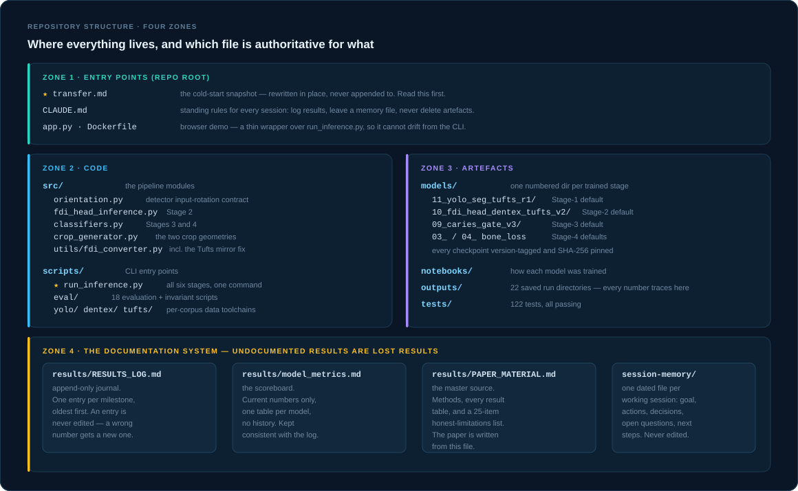

<div align="center">



<br>

[](https://www.python.org/)
[](https://pytorch.org/)
[](https://docs.ultralytics.com/)
[](app.py)
[](Dockerfile)
[](tests/)
[](scripts/eval/verify_invariants.py)
[](#c2--external-validation-on-four-hospitals)
[](#system-architecture)
[](LICENSE)

**Automated caries and periodontal bone-loss screening from a single panoramic dental X-ray.**<br>
Detect every tooth · number it in FDI notation · classify two pathologies per tooth · emit a structured report.

</div>

---

> ### START HERE
>
> **11 Oct 2026 — the tooth detector changed, and most of this page has not.** The Stage-1
> default is now a multi-corpus detector (`models/15_detector_multicorpus_leverA/arm3c_best.pt`,
> Tufts + DENTEX + Kaggle) in place of the Tufts-only seg model. It was made the default by a
> decision **against two pre-registered ablation verdicts, which stand**
> (`RESULTS_LOG` 2026-10-11f), and the pipeline was re-measured with both detectors on one
> machine (2026-10-11g). End-to-end numbering: Tufts 64.8% → 63.5% (not separable), DENTEX
> 58.4% → 92.8% (**in-domain** for the new detector). Default-pipeline caries F1 0.376 → 0.498.
> With it the pipeline scores *above* the image-blind constant on DENTEX — the reverse of this
> page's headline finding — while on the external cohorts that comparison is unchanged
> (`RESULTS_LOG` 2026-10-11i).
> **The rows marked 11 Oct below are current, and the manuscript was rebuilt on the new
> detector the same day** (`paper/main.tex`, `RESULTS_LOG` 2026-10-11k). **This page's own
> figures, the Docker image and every other "pipeline" number on it still describe the
> previous front end**, which is retained and selectable:
> `--detector models/11_yolo_seg_tufts_r1/best.pt`.
>
> **Picking this up cold — human or AI session? Read [`transfer.md`](transfer.md) first.** It is the
> living snapshot: where we are, what is verified done, what is next with the blocker named. It is
> rewritten in place every substantial session ([`CLAUDE.md`](CLAUDE.md) rule 5), so it is current
> in a way this README cannot be.
>
> | Question | File |
> |---|---|
> | A readable one-page overview — what was done, results, limitations, what's next | [`PROJECT_OVERVIEW.html`](PROJECT_OVERVIEW.html) — a **6 Sep 2026 snapshot**, not kept in sync; open in a browser (3-theme toggle). Internal / pre-submission. |
> | What are the current numbers? | [`docs/results/model_metrics.md`](docs/results/model_metrics.md) |
> | Full technical story + honest limitations (the paper is written from this) | [`docs/results/PAPER_MATERIAL.md`](docs/results/PAPER_MATERIAL.md) |
> | Why is it like this? What happened when? | [`docs/results/RESULTS_LOG.md`](docs/results/RESULTS_LOG.md) — 150 dated entries, append-only |
> | What should I work on? | [`docs/research/PUBLICATION_TODO.md`](docs/research/PUBLICATION_TODO.md), sequenced by [`MASTER_PLAN_2026H2.md`](docs/research/MASTER_PLAN_2026H2.md) |
> | How is the documentation laid out? | [`docs/README.md`](docs/README.md) |
> | What does the code do? | [`src/README.md`](src/README.md), [`scripts/README.md`](scripts/README.md) |
> | Which checkpoint is the pipeline default? | [`models/README.md`](models/README.md) |
> | Setting up on a new machine | [`transfer.md`](transfer.md) §8, [`docs/EXTERNAL_DRIVE.md`](docs/EXTERNAL_DRIVE.md) |
>
> **⚠️ Before running the pipeline on any non-Tufts image, rotate it 90° counter-clockwise.** The
> frozen detector was trained on sideways panoramics. Upright input gives 7.5% recall and 0% FDI
> accuracy. Use `src.orientation.detect_upright` — see [`src/README.md`](src/README.md).

---

## Table of contents

- [What this is](#what-this-is)
- [System architecture](#system-architecture)
- [Pipeline stages](#pipeline-stages)
- [Results](#results)
  - [C1 — the constant baseline that beats everything](#c1--the-constant-baseline-that-beats-everything)
  - [Where the 936 teeth go](#where-the-936-teeth-go--stage-2-failure-taxonomy)
  - [C2 — external validation on four hospitals](#c2--external-validation-on-four-hospitals)
  - [C4 — abstention](#c4--abstention-the-system-knows-when-to-decline)
  - [Calibration](#calibration--the-probabilities-are-not-probabilities)
- [Model zoo](#model-zoo)
- [Datasets](#datasets)
- [Repository structure](#repository-structure)
- [Setup and installation](#setup-and-installation)
- [Usage](#usage)
- [Reproducing every number](#reproducing-every-number)
- [Methodology and rigor practices](#methodology-and-rigor-practices)
- [Key engineering decisions](#key-engineering-decisions)
- [Known limitations](#known-limitations)
- [Bugs found and fixed](#bugs-found-and-fixed)
- [Universal → FDI conversion](#universal--fdi-conversion)
- [Publication target](#publication-target)
- [Contributing](#contributing)
- [License](#license)

---

## What this is

Orthopantomograms (OPGs, panoramic dental radiographs) are the routine first-line imaging modality
in general dentistry: one exposure captures the full dentition, both jaws and the surrounding
alveolar bone. Their interpretation is strongly reader-dependent. Early enamel/dentin caries and
early-to-moderate periodontal bone loss are low-contrast, small-area findings distributed across
~32 teeth in a single image, and the readers most likely to miss them — students and junior
clinicians — are exactly the ones least likely to have a specialist second opinion.

Two properties make this a good automation target:

- **The clinical output is structured and per-tooth, not per-image.** A useful report says
  "tooth 36: caries present, deep; bone loss present, moderate", keyed to the FDI World Dental
  Federation notation every dentist already uses.
- **The two pathologies live in different spatial supports of the same tooth** — caries in the
  crown, bone loss in the alveolar bone apical to the cemento-enamel junction. A whole-image
  classifier discards that structure; a tooth-centric pipeline preserves it.

**The constraint that shaped the entire design:** no single public dataset annotates teeth, caries
and bone loss together. The pipeline is therefore deliberately modular — each stage trains on the
dataset that actually carries its label (Tufts for detection and bone loss, DENTEX for caries) and
the stages are joined at inference time on the FDI key.

### Output format

```
Tooth 36
  → Caries: Yes | Depth: Deep
  → Bone Loss: Present | Severity: Moderate

Tooth 24
  → Caries: No
  → Bone Loss: Present | Severity: Mild
```

This is **shipped, not a design target**. [`scripts/run_inference.py`](scripts/run_inference.py)
joins all six stages into one runnable command: OPG in, per-tooth JSON + annotated overlay out.
[`app.py`](app.py) and the [`Dockerfile`](Dockerfile) wrap it for a browser demo.

> **"Shipped" does not mean "validated to clinical standard."** Every generated report carries a
> `limitations` field naming exactly what is still weak. This is a research prototype and a
> capstone project — not a medical device, and not for clinical use.

---

## System architecture

Six stages, with two parallel analysis branches running on **two different crops of the same
detected tooth box**.


The asymmetry between the two crops is the single most consequential design decision in the
pipeline, and it follows directly from anatomy — see
[Key engineering decisions](#key-engineering-decisions).

---

## Pipeline stages

| # | Stage | Input | Output | Status and current number |
|---|-------|-------|--------|---------------------------|
| 1 | **Tooth detection** — YOLOv11l, multi-corpus **(default since 11 Oct 2026)** | Full OPG, 1024 px | Tooth boxes (`nc=1`) | ✅ `tooth-detector-multicorpus-1024-v1.0`, trained on Tufts + DENTEX + Kaggle. Recall on held-out DENTEX **99.6%** (in-domain), on the Tufts test split **89.3%**. **Made the default against two pre-registered ablation verdicts**: its Tufts test box mAP@0.5 is **0.585** against the seg model's 0.810, and it has no masks. |
| 1′ | Tooth detection — YOLOv11l-seg *(previous default, retained, `--detector`)* | Full OPG, 1024 px | Tooth boxes (`nc=1`) | ✅ Test box **mAP@0.5 0.810**. Pipeline default frozen as `tooth-detector-seg-tufts-1024-v1.0`. Adopted for a **+2.76-point box gain** over the superseded bbox detector (0.7824). **Masks scored 0.638 against a pre-registered 0.65 bar — the bar was NOT met**; used for its **boxes only**, and mask-aware cropping stays unwired. |
| 2 | **FDI enumeration** — ResNet18 + 4 positional features | Tooth box + 1.5× crop | FDI-keyed tooth list | ✅ **11 Oct, current front end: DENTEX 92.8% exact end-to-end** [90.6, 94.9] — **in-domain** for the detector; **Tufts 63.5%** [59.3, 67.5]. No cross-domain figure exists for this front end. *Previous front end:* **58.3% exact end-to-end** [53.9, 62.8]; **82.6% of detected teeth** [79.1, 85.8]; quadrant 97.6%. Hungarian one-to-one over the 32 codes → **0 duplicate codes**. Pipeline default is head **v2.0** (DENTEX+Tufts), adopted for cross-domain robustness. |
| 3a | **Caries lesion detector** — YOLOv11l *(default since 4 Sep 2026, Lever B)* | Full OPG | lesion boxes → tooth | ✅ `caries-lesion-detector-yolo11l-leverb-bpooled-v1.0`. Tooth-level lesion agreement beats both the caries gate **and** an image-blind molar constant on **2 of 3** external cohorts (CariesXrays 68.4%, Ningxia 50.0%; DENTEX a statistical **tie**, 45.5%). First mechanism in this project to beat that constant anywhere. |
| 3a′ | **Caries gate** — ResNet18 *(retained variant, `--caries-method gate`)* | Tight 1.0× crop | caries / healthy | ✅ `caries-gate-resnet18-v3.0`. Held-out **P 0.398 / R 0.740**, **AP 0.550** against a 0.147 chance line (3.7× chance). Rebuilt on 5,366 real healthy teeth; in-pipeline caries rate **84.9% → 19.1%**. Every pre-4-Sep caries number was measured on it. |
| 3b | **Caries depth** — ResNet18 | Tight 1.0× crop | caries / deep_caries | ✅ acc **0.81**, macro F1 **0.77** (133 val crops). Validation only — no held-out test split exists for this head yet. Unchanged by Lever B — runs on teeth the lesion detector or gate flags. |
| 4a | **Bone-loss gate** — ResNet18 + focal loss | Expanded 1.5×W / 2.0×H crop | Present / Absent | ✅ macro F1 **0.9233**, sens 83.05%, spec 99.53% (1,558 val crops at real 4% prevalence). **Collapses out of domain** — see [C2](#c2--external-validation-on-four-hospitals). |
| 4b | **Bone-loss severity** — ResNet18 + focal loss | Same expanded crop | Mild / Moderate / Severe | ✅ macro F1 **0.7208** — but on **52 val crops**. Provisional. |
| — | *CEJ bone-level estimation (classical CV)* | Expanded crop | bone loss % | 🔬 **Negative result.** 15.1% exact agreement, 61.6% within ±1 class. **Not in the pipeline**, reported as a negative result. |
| 5 | **Fusion, flags, assessability** | All tooth outputs | Fused per-tooth record | ✅ Positional-alignment guard + confidence gating. Abstains below `ASSESSABILITY_MIN_FDI_CONFIDENCE = 0.30` → 90.8% coverage at 0.847 accuracy. |
| 6 | **Report** | Fused findings | Per-tooth JSON + overlay | ✅ **2.39 s/image on CPU.** Grad-CAM remains design-only. |

> **"Complete" means trained and running end to end — not validated to clinical standard.** What is
> honestly still weak, and is written into every generated report under `["limitations"]`: the
> adopted caries lesion detector has **no calibrated confidence and no abstention curve** (the
> retained gate's precision is **0.40**); the bone-loss branch **collapses outside Tufts** (fires
> on 0.7% of DENTEX teeth, 2.4% affected-tooth sensitivity on Ningxia) and, since report schema
> 1.2 (11 Oct 2026), is labelled for what it is — **a flag for teeth near an abnormality, not a
> periodontal finding**; tooth numbering is **92.8%** end to end only on DENTEX, which the
> detector was trained on — on the Tufts test split it is **63.5%**, and nothing measures it on
> a source the detector has not seen.

---

## Results

Full tables and provenance: [`docs/results/model_metrics.md`](docs/results/model_metrics.md).
Every number below traces to a saved artefact under `outputs/`, a
`models/<NN>_<name>/*summary*.txt`, or a run `results.csv`.
[`scripts/verify_paper_numbers.py`](scripts/verify_paper_numbers.py) asserts 127 manuscript numbers
against those artefacts, so numeric drift fails loudly.

| Model | Dataset | Split | Headline metric |
|---|---|---|---|
| YOLOv11l multi-corpus detection (**pipeline default since 11 Oct 2026**) | Tufts | **test** | mAP@0.5 box **0.585** — below both pre-registered guards; adopted for numbering, not for this |
| YOLOv11l-**seg** detection (previous default, retained) | Tufts | **test** | mAP@0.5 box **0.810** / mask 0.638 |
| YOLOv11l bbox detection — superseded, retained + hash-pinned | Tufts | val / **test** | 0.834 / **0.7824** |
| FDI enumeration head v2.0, **current front end** | DENTEX / Tufts | 164 / 143 held-out | DENTEX **92.8%** e2e / 93.2% of detected (in-domain); Tufts **63.5%** e2e / 71.1% of detected (11 Oct) |
| FDI enumeration head v2.0, previous front end | DENTEX / Tufts | 164 / 143 held-out | DENTEX **58.3%** e2e / **82.6%** of detected; Tufts **64.8%** e2e / **78.6%** of detected (3,760 teeth, 4 Sep) |
| **Caries lesion detector (Stage-3a default, Lever B)** | DENTEX / CariesXrays / Ningxia | frozen, tooth-level lesion agreement | DENTEX **45.5%** (tie), CariesXrays **68.4%** (win), Ningxia **50.0%** (win) — beats both the gate and the image-blind constant on 2 of 3 |
| Caries gate v3.0 *(retained variant)* | DENTEX | held-out test (863 crops) | P **0.398** / R **0.740**, AP **0.550**, ECE 0.136 |
| Caries depth (caries vs deep) | DENTEX | val (133) | acc **0.81**, macro F1 **0.77** |
| Bone-loss binary | Tufts | val (1,558, real prevalence) | macro F1 **0.9233** |
| Bone-loss severity (3-class) | Tufts | val (52) | macro F1 **0.7208** |
| **C1 — VLM baseline** | DENTEX | 164 leak-free | ours **F1 0.294** vs Qwen2.5-VL-32B **0.246** — and vs an image-blind constant **0.320** that beats both |
| **C2 — external validation** | Ningxia ×4 hospitals | locked, evaluated once | caries agreement **40.8%** pooled vs **44.3%** internal |
| **C2b — sixth cohort** | CariesXrays (AAAI 2024), 1,500 random images / 3,421 lesions | frozen pipeline, scored once | pipeline **0.309** vs image-blind constant **0.561** — paired Δ **+0.252 [+0.232, +0.273]**, the constant wins outright |
| CEJ estimation (exploratory) | Tufts | 296 crops | 15.1% agreement — negative result |

### C1 — the constant baseline that beats everything



The headline finding is **not** "small specialist beats large generalist", and this project refuses
to write it that way. A fixed list of the eight first and second molars — `{16,17,26,27,36,37,46,47}`,
fitted on the 78 leakage-excluded images, frozen, then applied without ever reading a pixel —
scores **F1 0.320**, above our pipeline's 0.294. Tooth-level FDI-set F1 is **base-rate dominated**,
and that control must appear beside every arm or the benchmark says nothing.

> **Measured 11 Oct 2026, pre-registered** ([`RESULTS_LOG.md`](docs/results/RESULTS_LOG.md)
> 2026-10-11). That 0.294 is the retired caries *gate*, and its gap to the constant is
> **+2.61 pp [−0.64, +5.99]** — the two are **not separable**, so "beats" in this section's title
> overstates it for our own pipeline (it holds against both VLMs). The lesion detector the
> pipeline has shipped since 4 Sep scores **F1 0.376** on the same 164 images and **does** beat
> the constant: **+5.64 pp [+1.74, +9.47]**. DENTEX is development data for that detector, and
> it is one run on one machine.

What survives:

- **Scale helps the VLM a lot** — 0.149 at 7B → 0.246 at 32B, zero-shot.
- **Few-shot makes it monotonically worse** — 0.066 at 2-shot, 0.034 at 4-shot — because in-context
  examples teach the model to answer *nothing*: empty predictions go 56 → 113 → 123 of 164.
- **Both models hand a confident dental answer to a random-noise image.** The 7B returns `26,36`
  for blank *and* noise input; the 32B returns `NONE` for blank and the full molar list for noise.
- **The efficiency claim holds regardless**: 33.45 B parameters and 70.1 GB of H100 VRAM lose to
  **61.2 M** parameters on a CPU — roughly **550×**, in the VLM's disfavour. *(This C1 run used
  the retained gate path; the shipped lesion-detector default is 75.3 M, ~444×.)*

### Where the 936 teeth go — Stage-2 failure taxonomy



*This subsection and its figure describe the previous front end. The multi-corpus detector it
calls an ablation became the default on 11 Oct 2026 — the ablation verdict is unchanged, the
default is not. Under it 932 of 936 DENTEX teeth are detected and 869 numbered correctly.*

**58.3% end-to-end is a detection-bound number, not a numbering score.** 275 teeth (29.4%) are
never detected and cannot be numbered at all. **Of the 661 teeth Stage 1 does find, Stage 2 numbers
82.6% correctly.** Both figures belong in any honest report of this system.

**And it is the detector's *domain* that binds, not its architecture — replicated across two runs
(Lever 1, 1 Sep; Lever A, 3 Sep).** Re-training the detector on pooled multi-corpus data and running
the *same frozen head* lifts end-to-end FDI to **~93%** on held-out DENTEX (Δ **+34.4 pp
[+30.3, +38.5]** with Lever A's 3–4 corpora; +34.9 pp with Lever 1's two; leakage ruled out three
ways). This is an **in-domain** number — the detector is now DENTEX-trained, where 58.3% was
Tufts→DENTEX cross-domain — and the multi-corpus detector is a pre-registered **ablation**: it
fails the Tufts box-mAP guard (Lever A: Control B 0.724 → 0.585, *monotonic in Tufts training
share*). A 3 Sep post-mortem
([`TUFTS_GUARD2_DIAGNOSIS.md`](outputs/lever_A_multicorpus_detector_v2/TUFTS_GUARD2_DIAGNOSIS.md))
confirms this is **capacity dilution, not a bug** — the multi-corpus arm misses 37% more Tufts
teeth and emits 42% more spurious boxes, box localisation unchanged; and the deployed Stage-1 is
*segmentation* (0.810 on this split) where every detection model here scores ≤ 0.724.
The tradeoff is **bidirectional**, though: the same detector Lever A can't adopt on Tufts
*improves* external caries lesion agreement by +9 pp pooled (Ningxia 0.41 → 0.60, CariesXrays
0.31 → 0.37). Numbering is not the bottleneck; detector domain coverage is — and you cannot serve
Tufts and the external cohorts with one single-class detector. See
[`PAPER_MATERIAL.md`](docs/results/PAPER_MATERIAL.md) §8.10.

The errors that remain are overwhelmingly benign: **89 of 115 wrong codes (77.4%) are off-by-one** —
right quadrant, adjacent position, usually the same tooth type. Only **16 of 661 detected teeth
(2.4%)** are category errors. The off-by-one drift splits 53 mesial / 36 distal, which is *not* the
one-sided lean an indexing bug would produce — a check worth reporting as having been made.

**The same taxonomy on Tufts** (3,760 teeth, 4 Sep 2026): correct **64.8%**, never detected
18.2%, off-by-one 12.6%, category errors 3.2%. Quadrant is 96.3% right on detected teeth — the
failure is purely the position digit, and 74% of Tufts numbering errors are benign off-by-one.
Improvement options were councilled 5 Sep 2026 — literature (SADP-Net on Tufts, anchor-and-extend
post-processing, spatial-prior transformers, unused public FDI corpora), a clean error
decomposition, a recommendation — in
[`docs/session-memory/2026-09-05b-tufts-fdi-improvement-council.md`](docs/session-memory/2026-09-05b-tufts-fdi-improvement-council.md).
**Both zero-GPU levers have now been run, and both are negative — which is what makes the
remaining explanation credible.** The positional-feature-shift diagnostic (6 Sep) moved
FDI-exact by **+0.1 pp**, so the Tufts↔DENTEX geometry difference is not the cause. **Lever C**,
the anatomical arch-order post-processor — pre-registered and frozen *before* any code, then run
— is a **null**: Tufts FDI-exact-of-detected **+0.29 pp [−0.07, +0.69]** against a +2.0 pp
lower-bound bar, DENTEX slightly down, so the default assignment is unchanged and both arms ship
behind `--assignment`. Its mechanism was measured rather than assumed: 72.6% of detections are
anchors the method cannot move, 13.4% sit in over-full quadrant groups, **13.9% are movable at
all** — and on the contiguous-arch stratum where its assumption holds it gains **+2.36 pp**.
What survives both eliminations is the **image-derived position digit** (73.5% on GT-box crops
vs DENTEX 91.9%); attacking it needs a better image pathway, which is post-submission and needs
its own pre-registration. Nothing is queued — Track A wins any time conflict. Detail in
[`RESULTS_LOG.md`](docs/results/RESULTS_LOG.md) 2026-09-06 and 2026-09-06b,
[`PAPER_MATERIAL.md`](docs/results/PAPER_MATERIAL.md) §8.16,
[`outputs/lever_C_fdi_structural_postproc/`](outputs/lever_C_fdi_structural_postproc/),
[`transfer.md`](transfer.md) §3.

Difficulty is also not where intuition puts it: molars are the **easiest** positions (13.0–14.9%
wrong-code rate on the largest support), because they are large, distinctive and terminal, so they
anchor arch ordering.

### C2 — external validation on four hospitals



Ningxia is **locked external test data** — never trained on, never tuned on, evaluated once, with
zero-leakage verified separately against Tufts and every DENTEX subset (0 of 2,912 unique test
hashes matched).

**Caries degrades gracefully.** Pooled external agreement is 40.8% against 44.3% internal — a
**3.5 pp gap**, down from 8.9 pp, more than halved by the detector swap alone. Only the external
gain is statistically real (+7.7 pp [+3.3, +12.0]); the internal one is not (+2.3 pp [−3.4, +7.9])
and is not quoted as an improvement. 40.8% remains weak in absolute terms and three of four
hospitals sit below the internal figure — this is not a claim that caries generalises well.

**Bone loss does not transfer, and this is reported rather than patched.** The standing hypothesis
was that the detector and the bone-loss branch failed out-of-domain for a shared reason. That
hypothesis was **tested and falsified**: swapping the detector moved Stage 2 by +12.0 points and
caries by +7.7 points, and bone loss by *nothing* — 168 affected teeth flagged before, 165 after,
while the denominator grew 9%. DENTEX carries no bone-loss labels, so the combined-training lever
never existed either. Full write-up: [`PAPER_MATERIAL.md`](docs/results/PAPER_MATERIAL.md) §8.13.

**A sixth cohort (1 Sep) makes the central claim its strongest.** The frozen pipeline was scored
on **CariesXrays** (Chen et al., AAAI 2024) — a random seed-fixed 1,500-image draw, **3,421 lesions**,
more than DENTEX and Ningxia combined. Against the image-blind molar constant: **pipeline 0.309,
constant 0.561, paired Δ +0.252 [+0.232, +0.273]** — the constant wins outright, and the mechanism
is visible (72.0% of lesions on molars, 60.2% on the eight constant teeth). Across all three
cohorts the constant is +0.046 (DENTEX), −0.009 (Ningxia, tie), **+0.252** (CariesXrays).
[`PAPER_MATERIAL.md`](docs/results/PAPER_MATERIAL.md) §8.25.

### C4 — abstention: the system knows when to decline



Declining the least-confident predictions raises accuracy on the retained ones — and the
**shuffled-confidence control** is what makes that meaningful: break the link between confidence
and correctness and the gain vanishes (+0.03 pp / +0.00 pp). The threshold was **not** tuned here.

### Calibration — the probabilities are not probabilities

The caries gate is **systematically overconfident**, not merely imprecise. Every reliability bin
lies below the diagonal: at a predicted P(caries) of 0.85 the observed frequency is **0.26**.

| | ECE | MCE | Brier | AP |
|---|---|---|---|---|
| Raw | 0.136 | 0.596 | 0.137 | 0.550 |
| + temperature scaling (T = 1.377) | 0.152 ❌ *worse* | 0.433 | 0.132 | 0.550 |
| + isotonic regression | **0.043** ✅ *−68%* | 0.334 | 0.098 | 0.500 ↓ |

The failure of temperature scaling is informative rather than embarrassing: it assumes a uniform
*scale* error, but the reliability curve is a *shape* error — flat at ~0.27 across predicted
0.50–0.85, then jumping to 0.69. One scalar cannot re-bend that. **The miscalibration is
structural, not a temperature effect.**

Isotonic fixes it but costs AP (0.550 → 0.500) and flips **18% of verdicts**. The adoption
decision is therefore deliberately partial: isotonic is applied to the *reported confidence* only,
leaving the verdict as `argmax` on raw logits — so every published downstream number stays exactly
as measured, and no further touch on locked external data is spent.

---

## Model zoo

The six default models total **95,343,545 learnable parameters** since the Stage-1 change of
11 Oct 2026 (`outputs/stage1_switch/H_params_arm3c/param_counts.json`); with the previous
detector, and in the manuscript, **97,649,753**
([`scripts/count_model_params.py`](scripts/count_model_params.py), one counting rule across every
checkpoint — re-derived 4 Sep 2026; the earlier 83.6 M figure mixed two conventions *and*
predated the Lever B adoption). Every one is version-tagged and SHA-256 pinned, and
[`scripts/eval/verify_invariants.py`](scripts/eval/verify_invariants.py) re-checks the hashes.

| Stage | Model | Directory | Params | Version tag | In git? |
|---|---|---|---|---|---|
| 1 | YOLOv11l multi-corpus **(default, 11 Oct)** | [`models/15_detector_multicorpus_leverA/`](models/15_detector_multicorpus_leverA/) (`arm3c_best.pt`) | 25,311,251 | `tooth-detector-multicorpus-1024-v1.0` | ✅ *(committed 11 Oct, 51 MB)* |
| 1 | YOLOv11l-seg *(previous default, retained)* | [`models/11_yolo_seg_tufts_r1/`](models/11_yolo_seg_tufts_r1/) | 27,617,459 | `tooth-detector-seg-tufts-1024-v1.0` | ✅ *(committed 3 Sep, 53 MB)* |
| 1 | YOLOv11l bbox *(superseded)* | [`models/06_yolo_detection_a100_run/`](models/06_yolo_detection_a100_run/) | 25.3 M | `tooth-detector-a100-1024-v1.0` | ❌ Drive |
| 2 | ResNet18 + 4 positional feats | [`models/10_fdi_head_dentex_tufts_v2/`](models/10_fdi_head_dentex_tufts_v2/) | 11,187,916 | `fdi-enumeration-head-resnet18-v2.0` | ✅ |
| 2 | FDI head v1.0 *(superseded)* | [`models/08_fdi_enumeration_head/`](models/08_fdi_enumeration_head/) | 11.2 M | `fdi-enumeration-head-resnet18-v1.0` | ✅ |
| 3a | YOLOv11l caries lesion detector **(default, Lever B, 4 Sep)** | [`models/16_lever_b_pooled/`](models/16_lever_b_pooled/) | 25,311,251 | `caries-lesion-detector-yolo11l-leverb-bpooled-v1.0` | ✅ *(committed 4 Sep, 51 MB)* |
| 3a′ | ResNet18 caries gate *(retained variant, `--caries-method gate`)* | [`models/09_caries_gate_v3/`](models/09_caries_gate_v3/) | 11,177,538 | `caries-gate-resnet18-v3.0` | ✅ *(committed 3 Sep, 43 MB)* |
| 3b | ResNet18 caries severity | [`models/07_caries_cascade/`](models/07_caries_cascade/) | 11,177,538 | `caries-cascade-resnet18-v1.0` | ✅ |
| 4a | ResNet18 bone-loss gate | [`models/03_bone_loss_model_training_notebook_models/`](models/03_bone_loss_model_training_notebook_models/) | 11,177,538 | `bone-loss-binary-resnet18-v1.0` | ✅ |
| 4b | ResNet18 bone-loss severity | [`models/04_bone_loss_severity_notebook_models/`](models/04_bone_loss_severity_notebook_models/) | 11,178,051 | `bone-loss-severity-resnet18-v1.0` | ✅ |
| | **Total, six default models** (3a = lesion detector) | | **95,343,545** | | |
| | Total with the `--caries-method gate` variant instead | | 81,209,832 | | |
| | **Caries path only** (stages 1, 2, 3a-default, 3b) | | **72,987,956** | | |
| | *The same three totals with the previous Stage-1 detector* | | *97,649,753 / 83,516,040 / 75,294,164* | | |
| | Caries path, `--caries-method gate` (1, 2, 3a-gate, 3b) | | 61,160,451 | | |

> ⚠️ **Do not quote "~25 M" for this pipeline.** That is the *superseded bbox detector alone* —
> and, coincidentally, also the new Stage-3a lesion detector's own count (25.3 M); the two are
> different models and must not be conflated. The "~25 M" figure had propagated into nine places
> across six files before anyone counted it
> ([`RESULTS_LOG.md`](docs/results/RESULTS_LOG.md) 2026-08-28). The efficiency comparison against
> Qwen2.5-VL-32B-Instruct is **33.45 B vs 75.3 M** (current default; the retained gate path is
> 61.2 M) — roughly **444×**.

**Also present, not pipeline defaults:** [`models/12_fdi_head_v3_3corpus/`](models/12_fdi_head_v3_3corpus/)
(three-corpus head — an **ablation**: +1.14 pp on DENTEX val, significant; +0.74 pp on Tufts, not
significant; the +15.45 pp Kaggle cell is *not* a generalisation result because v3 trained on that
corpus) and [`models/12a_fdi_head_v2_control_rebuilt/`](models/12a_fdi_head_v2_control_rebuilt/)
(its same-day control); [`models/13_detector_multicorpus_lever1/`](models/13_detector_multicorpus_lever1/)
(Lever 1 — the multi-corpus detector, an **ablation**: +34.9 pp end-to-end FDI on DENTEX but fails
the Tufts guard, `RESULTS_LOG` 2026-09-01h) and
[`models/15_detector_multicorpus_leverA/`](models/15_detector_multicorpus_leverA/) (Lever A — the
same experiment with 4 pooled corpora + balanced sampling, **also an ablation**: primary and the
*external-caries* guard pass (+34.4 pp DENTEX e2e; +9.1 pp pooled Ningxia + CariesXrays agreement)
but the Tufts-test guard fails, `RESULTS_LOG` 2026-09-03 + 03b — the in/out-of-domain tradeoff is
bidirectional and quantified);
[`models/14_cariesxrays_lever2/`](models/14_cariesxrays_lever2/) (Lever 2 — a standalone
caries-**lesion** detector on the CariesXrays benchmark, **benchmark row only, not in the
pipeline**: YOLOv11l reaches COCO **AP 0.482 / AP50 0.845** on this project's own seed-42 split —
level with the task-specific FPCL method, ~6 AP over the strongest of their ten baselines; the
official FPCL split is not public so the comparison is *indicative*, `RESULTS_LOG` 2026-09-02b;
it is also **Lever B's single-corpus arm**, which wins CariesXrays outright but collapses to
**8.6%** tooth-level lesion agreement on DENTEX — a strong benchmark number and a failure to
transfer in one model);
plus [`models/05_cej_estimation_v2_models/`](models/05_cej_estimation_v2_models/)
(the exploratory CEJ negative result).

[`models/16_lever_b_pooled/`](models/16_lever_b_pooled/) is **no longer an ablation** — it was
**adopted 4 Sep 2026 as the Stage-3a caries default** once Ningxia was scored and the
pre-registered Sec 6 rule was met on 2 of 3 cohorts (`RESULTS_LOG` 2026-09-04h). It is in the
default table above; `models/14` is its retained single-corpus arm.

### Architecture specifications

| | Stage 1 detector | Stage 2 FDI head | Caries cascade | Bone-loss binary | Bone-loss severity |
|---|---|---|---|---|---|
| Architecture | YOLOv11l-seg | ResNet18 + 4 positional features | ResNet18 ×2 (ImageNet) | ResNet18 (ImageNet) | ResNet18 (ImageNet) |
| Input | 1024 px OPG | 224×224 crop at 1.5× + `[cx,cy,bw,bh]` | 224×224 **tight** crop, no expansion | 224×224 at 1.5×W / 2.0×H | same expanded crop |
| Head | — | (512+64) → 4 and → 8 | 512 → 2 | 512 → 2 | 512 → 3 |
| Output | tooth boxes, `nc=1` | quadrant (4) × position (8) → FDI | caries/no → caries/deep | Present / Absent | Mild / Moderate / Severe |
| Assignment | NMS IoU 0.50, conf 0.25 | **Hungarian one-to-one** over 32 codes | argmax | argmax | argmax |

**Training configuration — bone-loss binary** (the most-tuned classifier):

| Parameter | Value |
|---|---|
| Loss | Focal Loss (γ = 2.0, α = [0.642, 2.258]) |
| Optimizer | Adam, lr 1e-4, weight decay 1e-4 |
| Scheduler | ReduceLROnPlateau (patience 5) |
| Batch size | 32 |
| Epochs | 50 budgeted / 32 run, best epoch 22 (early stopping on val macro-F1, patience 10) |
| Augmentation | H-flip, brightness jitter, rotation ±10°, bbox jitter ±15% |
| Class imbalance | 23.8× — undersampling + minority augmentation + focal loss |

> **This model overfits, and the training curves are published rather than hidden.** Train loss
> falls 0.126 → ~0.002 while validation loss flattens near 0.05 from about epoch 5 and never
> improves — a ~25× gap. With 711 positive training crops, partly augmented duplicates of the same
> teeth, that is expected. Figure: `docs/results/figures/paper/stage4a_training_curves.png`.

**Detector augmentation is clinically constrained:** horizontal flip, ±10° rotation, small
translate/scale, HSV-value jitter. **No vertical flip** (an inverted jaw is anatomically
meaningless), **no mosaic**, **no mixup** — both destroy the global jaw geometry that tooth
ordering depends on.

---

## Datasets

### Tufts Dental Database — detection + bone loss

| Component | Count |
|---|---|
| Radiographs | 1,000 OPGs, 840 × 1615 px (uniform) |
| Tooth bounding boxes | 26,005 across 968 images |
| Expert reports | 1,000 free-text radiology diagnoses |
| Expert pathology masks | 439 (285 empty/normal + 154 annotated) |
| Detection split | **700 / 150 / 150** frozen image-level train/val/test |
| Bone-loss crops built | 22,806 — 23.84× class imbalance (96% normal / 4% diseased) |

### DENTEX — caries + FDI enumeration

| Split / class | Count |
|---|---|
| Phase 1 train — `caries` / `no_caries` | 2,767 / 762 |
| Phase 2 val — `caries` / `deep_caries` | 101 / 32 (133 total) |
| Caries gate v3 negatives | 5,366 real healthy teeth (MD5 join, 98.28% FDI agreement) |
| Stage-2 evaluation set | **164 leak-free images**, 936 FDI-labelled teeth |

> **86 of the original 250 evaluation images are excluded as training duplicates** — 85
> byte-identical to enumeration-head training images, 1 to a detector training image. An earlier
> table reported 52.2% on the contaminated 249-image set; that figure was **inflated by 5.7 points
> and is withdrawn**. Exclusion list: `data/dentex/disease_leaked_images.json`.

### Ningxia — locked external test, 4 hospitals

| | |
|---|---|
| Splits | test1–test4, four independent centres |
| Images | 736 |
| Caries lesions | 1,013 (316 / 349 / 162 / 186) |
| Periodontitis-affected teeth | 6,791 |
| Leakage | **0 of 2,912** unique test hashes matched any training corpus |
| Policy | **Never train on it, never tune on it.** Evaluated once. |

> All four splits are **equally external to us**. Ningxia's own split design labels one of them
> "same-centre-as-train" — that describes *Ningxia's* training set, not ours. Describing it as
> "in-domain" for this pipeline would be wrong.

### Dataset characteristics and gotchas

| Property | Value |
|---|---|
| Avg teeth per image | 26.9 |
| Tooth aspect ratio | ~0.35 — 3× taller than wide |
| Michelson contrast | 0.999 |
| Bbox coordinate format | **Frame-dependent** — `[y1,x1,y2,x2]` landscape (bone-loss path) or `[x1,y1,x2,y2]` portrait (FDI path) |
| Polygon coordinate format | `[y, x]` — **transposed relative to the bbox file** |
| Tooth numbering | Universal (1–32), and **left-right mirrored** in Tufts (Tufts "1" = FDI 28, not 18) |
| Join key | nested `External ID` field, not the filename stem |

Each of those four rows is a bug that was found the hard way. See
[Bugs found and fixed](#bugs-found-and-fixed).

---

## Repository structure



<details>
<summary><b>Full tree</b></summary>

```
├── README.md                    ← you are here
├── transfer.md                  ← ★ START HERE cold — living state snapshot
├── PROJECT_OVERVIEW.html        ← readable one-page project snapshot (6 Sep 2026, not maintained)
├── CLAUDE.md                    ← standing rules for AI/automation sessions
├── app.py · Dockerfile          ← Streamlit demo, CPU-only container
├── requirements.txt · setup.py · LICENSE
│
├── configs/dataset_config.yaml  ← paths, hyperparameters, Universal→FDI table
│
├── src/
│   ├── orientation.py           ← detector input-rotation contract
│   ├── fdi_head_inference.py    ← Stage 2 — learned enumeration head
│   ├── fdi_assignment.py        ← Hungarian one-to-one assignment
│   ├── classifiers.py           ← Stages 3/4 — caries + bone-loss cascades
│   ├── crop_generator.py        ← the two crop geometries
│   ├── data_loader.py · label_assigner.py
│   └── utils/                   ← fdi_converter (incl. Tufts mirror fix), visualization, constants
│
├── scripts/
│   ├── run_inference.py         ← ★ CLI: all six stages, OPG in → JSON + overlay out
│   ├── verify_paper_numbers.py  ← asserts 127 manuscript numbers against artefacts
│   ├── verify_citations_crossref.py  ← dereferences every DOI against the registry (22 fixed, 2 Sep)
│   ├── audit_citations.py · check_text_reuse.py · build_handbook.py
│   ├── eval/                    ← 21 evaluation + invariant scripts (+ README)
│   ├── yolo/                    ← Stage-1 detection + Lever-1/2 detector toolchains (+ README)
│   ├── dentex/ · tufts/ · kaggle_dual/   ← per-corpus data toolchains (+ READMEs)
│   └── figures/                 ← paper figure generators
│
├── notebooks/
│   ├── yolo_detection/          ← Stage 1 — the competing runs (+ README)
│   ├── caries/                  ← Stage 3 — DENTEX cascade + approach.txt
│   └── bone_loss/               ← Stage 4 — 6 notebooks, exploration → CEJ
│
├── models/                      ← one numbered dir per trained stage, 06–14 (see models/README.md)
├── data/                        ← tufts · dentex · ningxia · kaggle_dual · ufba425 · detector_multicorpus{,_v2} · cariesxrays_det (large files gitignored)
├── outputs/                     ← saved run directories — every number traces here
├── paper/                       ← main.tex · main.pdf · source.bib · figures
├── tests/                       ← 174 tests
│
└── docs/                        ← ★ start at docs/README.md
    ├── assets/                  ← the animated SVG diagrams in this README
    ├── architecture/            ← pipeline diagrams (+ drawio source)
    ├── results/
    │   ├── PAPER_MATERIAL.md    ← ★ master paper-writing document
    │   ├── RESULTS_LOG.md       ← append-only journal, 150 entries
    │   ├── model_metrics.md     ← one-page scoreboard
    │   ├── METHODOLOGY_CHANGELOG.md
    │   └── figures/paper/       ← 17 paper/review figures
    ├── paper/REBUILD_AUDIT.md   ← the 28 Aug evidence audit behind main.tex
    ├── exploration/README.md    ← dataset quirks + the critical bugs caught
    ├── session-memory/          ← one dated file per working session
    ├── reports/ · research/     ← report PDFs; parallel planning workstream
    └── EXTERNAL_DRIVE.md        ← where the gitignored checkpoints live
```

</details>

> Bulky untracked material (a stale nested clone, the 2.2 GB raw-data workspace, the YOLO run
> directory, duplicate diagrams, superseded paper drafts) was **relocated, never deleted**, to
> `_repo_archive/` — a sibling folder outside this repo. See `_repo_archive/ARCHIVE_MANIFEST.md`
> for the inventory and one-line restore commands. That is [`CLAUDE.md`](CLAUDE.md) rule 3.

---

## Setup and installation

### Prerequisites

- Python 3.12 or 3.13 (the environment was rebuilt on 3.13; the Docker image pins 3.12-slim)
- A CUDA GPU for *training*. **Inference runs on CPU** at 2.39 s/image.

```bash
git clone https://github.com/csdeepak/An-Intelligent-Dental-Assisting-System-for-Dentists-in-Cavity-and-Periodontal-Disease-Detection.git
cd An-Intelligent-Dental-Assisting-System-for-Dentists-in-Cavity-and-Periodontal-Disease-Detection
python -m venv venv && source venv/bin/activate   # Windows: venv\Scripts\activate
pip install -r requirements.txt
```

> **`numpy` must stay below 2.0, and this is load-bearing.** torch, scipy 1.12 and scikit-learn 1.4
> are compiled against numpy 1.x. Installing numpy 2.x breaks torch↔numpy conversion,
> `scipy.optimize.linear_sum_assignment` — *which is the Stage-2 Hungarian assignment* — and
> sklearn entirely, **silently, at import time.** The Docker build re-checks this and fails loudly.

### Fetching the checkpoints

**Since 11 Oct 2026 the default tooth detector is `models/15_…/arm3c_best.pt` (51 MB), committed
the same day** via the same kind of `.gitignore` exception — `git clone` is still enough.

**As of 3 Sep 2026 `git clone` is enough to run the pipeline** — the three `DEF_*` checkpoints
(`models/11/best.pt` 53 MB, `models/09/caries_gate_v3.pth` 43 MB, `models/10/…head` 43 MB) are
committed via `.gitignore` exceptions (private repo; `models/11` is 3 MB over the
[`CLAUDE.md`](CLAUDE.md) rule-4 line — see [`transfer.md`](transfer.md) §4, reversible).

Still on Drive only ([`docs/EXTERNAL_DRIVE.md`](docs/EXTERNAL_DRIVE.md)):

```
models/06_yolo_detection_a100_run/best.pt      ← superseded detector, only for pre-27-Aug reproduction
models/13, 15, 16 lever weights                ← ablation artefacts; SHA-256 in each run_summary.txt
```

`models/14_cariesxrays_lever2/weights/best.pt` (Lever B's B-single arm) is **committed to git**
(4 Sep 2026, sha256-verified `278d1e00…`) — no Drive round-trip needed.

### Verify the install

```bash
python -m pytest tests/ -q
```

```bash
python scripts/eval/verify_invariants.py
```

The first should report `174 passed`. The second should print `all invariants hold` — it re-checks
frozen weight hashes, checkpoint class orders, crop-contract distinctness, caries dataset hygiene,
the leakage exclusion list, and the MD5 join behind the v3 negative class.

---

## Usage

### Full pipeline inference

```bash
python scripts/run_inference.py --image path/to/opg.jpg --output report.json --overlay viz.jpg
```

Every stage's checkpoint is overridable (`--detector`, `--fdi-head`, `--caries-gate`,
`--caries-severity`, `--bone-loss`, `--bone-severity`), as are the detector's operating points
(`--conf` 0.25, `--imgsz` 1024, `--det-iou` 0.50). `--no-one-to-one` disables the Hungarian
assignment — useful for ablation, and it costs 4.3 points of FDI-exact accuracy while emitting 679
anatomically impossible duplicate codes.

### Browser demo

```bash
streamlit run app.py
```

```bash
docker build -t dental-ai . && docker run -p 8501:8501 dental-ai
```

Both are a **thin wrapper** around `run_inference.py` — they call the same `load_models` and
`run_pipeline` functions the CLI uses. There is no second implementation, so the demo cannot
silently drift from what the CLI proves out, and it inherits every fix and every limitation
automatically. The `limitations` block is rendered directly under the results, at the same size as
everything else, so it cannot be screenshotted away from the numbers it qualifies.

### Training

```bash
python scripts/yolo/convert_tufts_to_yolo_seg.py   # Tufts → YOLO-seg format + data.yaml
python scripts/yolo/train_yolo_seg.py              # fine-tune YOLOv11l-seg at imgsz 1024
python scripts/yolo/evaluate_yolo.py               # evaluate on the held-out test split
```

```bash
python scripts/dentex/train_enumeration_head.py    # Stage 2
python scripts/dentex/train_caries_cascade.py      # Stage 3
python scripts/build_dataset.py --config configs/dataset_config.yaml   # Stage 4 crops
python scripts/train_model.py   --config configs/dataset_config.yaml   # Stage 4 model
```

> `convert_tufts_to_yolo_seg.py` **picks its image directory by measuring against
> `teeth_bbox.json`, not by name**, and re-scores the labels it wrote afterwards, exiting non-zero
> if they disagree. That gate exists because a 90-epoch A100 run was silently voided by misaligned
> masks — see [Bugs found and fixed](#bugs-found-and-fixed).

---

## Reproducing every number

| Claim | Script | Artefact |
|---|---|---|
| Stage-2 end-to-end FDI accuracy | `scripts/eval/validate_fdi_assignment.py` | `outputs/stage2_segdet/` |
| Stage-2 failure taxonomy | `scripts/eval/stage2_failure_taxonomy.py` | `outputs/stage2_taxonomy/` |
| Stage-2 ceiling vs positional method | `scripts/eval/analyze_stage2_ceiling.py` | — |
| Head input ablation | `scripts/eval/ablate_head_inputs.py` | — |
| Cross-corpus crop-level head comparison | `scripts/eval/crop_eval.py` | — |
| Caries gate repair (v1 vs v3, in-pipeline) | `scripts/eval/compare_caries_gates.py` | — |
| Caries failure panel | `scripts/eval/caries_failure_panel.py` | `outputs/caries_failure_panel/` |
| Calibration, temperature, isotonic | `calibration_pr.py`, `temperature_scale.py`, `isotonic_calibrate.py` | `outputs/calibration/` |
| Lesion-localisation agreement | `scripts/eval/lesion_localization.py` | `outputs/lesion_loc_*/` |
| **C1** — VLM + constant baselines | `c1_vlm_baseline.py`, `c1_constant_baseline.py` | `outputs/c1_vlm/` |
| **C2** — Ningxia external validation | `scripts/eval/ningxia_external.py` | `outputs/ningxia_*/` |
| **C4** — coverage–accuracy | `scripts/eval/c4_coverage_accuracy.py` | `outputs/c4_abstention/` |
| Confidence intervals (all of the above) | `scripts/eval/bootstrap_ci.py` | `outputs/bootstrap_ci/` |
| Bone-loss evaluation | `scripts/eval/bone_loss_eval.py` | `outputs/bone_loss_eval/` |
| Frozen hashes, class orders, crop contracts, leakage | `scripts/eval/verify_invariants.py` | — |
| **C2b** — CariesXrays sixth cohort (frozen pipeline) | `scripts/eval/cariesxrays_external.py` | `outputs/cariesxrays_external*/` |
| **Lever 1 / A** — multi-corpus detector (ablations) | `scripts/yolo/build_multicorpus_detector{,_v2}_dataset.py`, `train_multicorpus_detector{,_v2}.py`, `scripts/eval/score_lever{1,A}_arm.py` | `models/13_detector_multicorpus_lever1/`, `models/15_detector_multicorpus_leverA/` (+ `repro/` + `repro/diagnostics/`), `outputs/lever_A_multicorpus_detector_v2/` (+ `TUFTS_GUARD2_DIAGNOSIS.md`) |
| **Lever 2** — CariesXrays lesion detector (trained; benchmark row) | `scripts/yolo/build_cariesxrays_detector_dataset.py`, `scripts/yolo/train_cariesxrays_detector.py` | `models/14_cariesxrays_lever2/`, `outputs/lever2_cariesxrays/` |
| **Lever B** — lesion-detection caries path (both arms trained/evaluated 4 Sep; Sec 6 met on 2/3 cohorts → `models/16` adopted as Stage-3a default) | `scripts/dentex/build_dentex_caries_boxes.py`, `scripts/yolo/{build_lever_b_pooled_dataset,train_lever_b_pooled_detector}.py`, `scripts/eval/{lesion_localization,ningxia_external,cariesxrays_external}.py` (`--decision lesion-detector`), `scripts/eval/lever_b_bootstrap.py` | `models/{14,16}_*` (B-single / B-pooled), `outputs/lever_b_eval/`, `outputs/lever_B_lesion_caries_path/PRE_REGISTRATION.md` (frozen) |
| DOI integrity of every citation | `scripts/verify_citations_crossref.py` | `outputs/citation_audit/` |
| The 127 manuscript numbers | `scripts/verify_paper_numbers.py` | `paper/main.tex` |

Paper figures regenerate from **saved run artefacts only, never re-measured**:
`scripts/figures/make_paper_figures.py`, `make_baseline_figure.py`,
`make_boneloss_paper_figure.py`, `make_stage34_figures.py`.

---

## Methodology and rigor practices

The contribution of this project is **not peak accuracy** — several published numbers on these
datasets are higher. It is that these numbers survive contact with an external test set, carry
intervals, and come with a stage-wise attribution of where the errors are. The practices below are
what make that claim checkable.

**Pre-registration.** The R1 detector retrain had its acceptance bars written down *before* the
run: box mAP@0.5 ≥ 0.75, mask ≥ 0.65. Box passed at 0.810; **mask failed at 0.6383, short by
0.0117**. The bar was **not moved after seeing the number.** The model was adopted anyway by an
explicit, dated human decision on the strength of the box result — and the consequence was
enforced: it is used for its **boxes only**, and mask-aware cropping stays unwired because that
floor existed to protect it. Adoption ≠ the bar being met; both facts are on the record.

**Leakage control, applied per corpus.** 86 of 250 DENTEX evaluation images were found to be
byte-identical duplicates of training images and excluded; the inflated 52.2% figure they produced
was withdrawn rather than quietly restated. Ningxia was hash-checked separately against Tufts and
each of the five DENTEX subsets. Splits are **image-level (patient-level)** by design — all crops
from one radiograph, including jittered copies, stay in the same split, because a crop-level split
leaks patient-specific exposure and anatomy. **One exception was found on 10 Oct 2026: the
bone-loss models.** The run that produced the shipped Stage-4a checkpoint fell back to a
crop-level 20% split, so all 143 of its validation radiographs also supply training crops and 46
of its 59 validation positives share their tooth with a training positive. Its 0.9233 is therefore
not a held-out estimate ([`RESULTS_LOG.md`](docs/results/RESULTS_LOG.md) 2026-10-10).

**Confidence intervals by cluster bootstrap over images**, 10,000 resamples, seed 42 — resampling
*images* rather than *teeth*, because teeth within a radiograph are not independent and a
tooth-level bootstrap reports intervals far too narrow. **Two deltas reported earlier did not
survive their intervals** (detection recall +3.3 pp, DENTEX-internal lesion agreement +2.3 pp) and
are explicitly not quoted as improvements.

**Paired significance testing.** Head comparisons use McNemar on the same items; the rejected
Tufts-only head lost 9.1 points on DENTEX (p = 4.7×10⁻¹¹) while its edge on Tufts was not
significant (p = 0.732), so v2.0 strictly dominates it. Detector-swap deltas are measured against a
**same-machine control run of the old configuration first**, so the delta is attributable to the
model rather than the environment — and the control's ~3-tooth drift from the originally published
figure is stated rather than hidden.

**Controls for every headline.** The VLM baseline is reported beside an image-blind constant that
beats it *and* us. The abstention result is reported beside a shuffled-confidence control. Blank
and random-noise images are fed to both VLMs to check whether the answer depends on the input.

**A falling loss curve is not evidence of correct data.** One 90-epoch A100 run completed cleanly,
with healthy throughput and checkpointing and every hyperparameter matching its pre-registration —
and was **scientifically void**, because every instance mask was spatially misaligned. What caught
it was comparing against a known reference (0.258 val mAP against the canonical detector's 0.834)
and treating the gap as *a defect to explain* rather than a disappointing number to report.
Geometry is now verified against an independent annotation source **before** training, in code that
exits non-zero rather than in a doc that can go stale.

**Numbers are pinned to artefacts.** `verify_paper_numbers.py` asserts 127 manuscript numbers
against their JSONs; `verify_invariants.py` asserts frozen weight hashes and dataset hygiene;
174 unit tests cover the coordinate conversions, the FDI table, the crop contracts and the
orientation contract (both directions — including the `rot_box` inverse added for the Lever 1
detector retrain). A wrong parameter count once propagated into nine places across six files
before it was caught — these checks exist so that class of drift fails loudly next time.
**Citations are dereferenced too:** a 1 Sep audit against the DOI registry found 22 of 63
checkable DOIs broken (`verify_citations_crossref.py`). **All 22 were fixed 2 Sep** — every one
turned out to be a real, published paper carrying a wrong identifier (none fabricated); the
corrected DOIs re-verify against the registry, and 19 of them also had a wrong volume/pages that
were corrected from the registry record (`outputs/citation_audit/RESOLUTION_2026-09-02.md`).

---

## Key engineering decisions

**1 — Asymmetric crop expansion, 1.5× width and 2.0× height.** Teeth have a mean aspect ratio of
~0.35 — three times taller than wide. Equal expansion bleeds into adjacent teeth horizontally while
under-covering vertically. More vertical expansion captures the alveolar bone below the root, which
is exactly where bone loss is visible. The caries path, by contrast, uses the **raw box with no
expansion**, because caries appears on enamel and dentin in the crown. Two pathologies, two
supports, two crops of the same box.

**2 — Pixel-overlap ratio instead of IoU.** `overlap = mask_pixels_inside_crop / crop_area`.
Expert mask blobs are tiny sparse lesion annotations (0.5–2% of an expanded crop), so
IoU ≈ tiny/large ≈ 0 and *every* crop — true positives included — would be labelled negative.
Threshold 0.01, defensible range 0.005–0.02. The same quantity doubles as the severity axis:
mild ≤ 0.05, moderate 0.05–0.15, severe > 0.15.

**3 — Binary classification instead of severity segmentation.** U-Net was ruled out on evidence,
not preference: expert masks encode **per-lesion instance IDs, not severity classes**; no
pixel-level mild/moderate/severe annotation exists; only 154 annotated samples do; and CEJ
ground-truth points are absent from the dataset entirely.

**4 — Hungarian one-to-one assignment over the 32 FDI codes.** Plain argmax emits **679
anatomically impossible duplicate codes** and scores 65.1% / 43.6%. The global one-to-one
constraint removes **all** of them for 69.4% / 46.5% — **+4.3 points of-detected, +2.9 end-to-end** —
at a cost of 2.1 points of raw quadrant accuracy, because the constraint sometimes moves a tooth
across a quadrant boundary. A mouth cannot contain two tooth 36s; the model should not be allowed
to say it does.

**5 — A learned enumeration head instead of positional sorting.** Rank-order sorting reaches 22.9%
end-to-end. The head reaches 58.3%. On the population where sorting is at its *best* — teeth in
complete 8-detection quadrants — positional reaches 66.3% and the head 80.2%, a **+13.9-point
margin on the same population**. An order-independent method exceeds what rank-order can reach, and
not marginally.

**6 — Bbox jitter (±15%) to emulate detector noise.** Training crops come from ground-truth boxes;
inference crops come from detector predictions with localisation error. The input ablation shows
this is cheap insurance rather than a crutch: realistic box error costs ~nothing (±15% leaves FDI
exact unchanged to 0.1 pp; ±100% costs 0.2 pp). Shuffled coordinates cost 22.9 points, but a
shuffle teleports a coordinate across the mouth and does not occur in practice.

---

## Known limitations

Stated plainly, because a screening aid that oversells itself is worse than one that does not
exist. The full 25-item treatment is [`PAPER_MATERIAL.md`](docs/results/PAPER_MATERIAL.md) §8.

| # | Limitation | Status |
|---|---|---|
| 1 | **The bone-loss branch does not generalise.** 0.9233 in-domain → 0.7% firing on DENTEX → 2.4% affected-tooth sensitivity on Ningxia. | **Decided limitation, reported not fixed.** The shared-root-cause hypothesis was tested and falsified; DENTEX has no bone-loss labels, so the combined-training lever never existed. |
| 2 | **Caries precision is 0.40** — roughly six of ten positives are wrong. | Improved from a 7.3× over-call to 1.6×, not solved. 96.5% of false positives are *healthy* teeth, not other pathology — which rules out the obvious remedy. |
| 3 | **The tooth detector is only measured where it was trained.** Since 11 Oct 2026 it finds 99.6% of DENTEX teeth and 89.3% of Tufts teeth — both corpora it trained on — and its Tufts box mAP@0.5 is 0.585, below the 0.810 of the model it replaced. With the previous detector recall on DENTEX was 70.6%. | Changed by decision against two pre-registered verdicts, then re-measured. No cross-domain numbering figure exists. |
| 4 | **Severity heads rest on tiny validation sets** — 52 crops (bone loss), 133 (caries depth). | Provisional. The 0.72 target was met by 0.0008 on 52 samples. |
| 5 | **Tooth-level scores are base-rate dominated** — an image-blind molar constant beats the pipeline on FDI-set F1 (C1) *and* on caries lesion agreement across three cohorts (Δ up to **+0.252** on CariesXrays, 3,421 lesions). | Reported as the headline finding, not buried. This is what the paper is *about*. |
| 6 | **The caries gate is miscalibrated** (ECE 0.136, systematically overconfident). | Isotonic fixes it to 0.043, applied to reported confidence only; verdicts unchanged so published numbers stay valid. |
| 7 | **The negative class rests on presumed-negative labelling.** DENTEX "healthy" means *no disease annotation*; several high-confidence false positives visibly carry restorations — and a restored tooth has already been treated for caries. | Flagged as an observation for a clinician to confirm, **not yet a claim**. |
| 8 | **The bone-loss classifier has no calibration analysis.** Its metadata carries no bounding boxes, so the crops need a geometry-verified rebuild first. | Open. A silent crop-geometry mismatch is exactly what voided the R1 run. |
| 9 | **Stage-4a overfits** — ~25× train/val loss gap. | Measured and published rather than hidden. |
| 10 | **CEJ estimation is a negative result** (15.1% agreement). | Not integrated; reported as a negative result. |
| 11 | **Mask-aware cropping is unwired** because the mask bar was missed. | Deliberate consequence of the pre-registered bar. |
| 12 | **No clinical validation, no IRB, and four non-engineering compliance items are open.** | ⛔ **Blocking for publication.** See below. |
| 13 | ~~22 of 63 checkable DOIs in `source.bib` are broken~~ **RESOLVED 2 Sep.** All 22 were real papers with wrong identifiers; fixed + re-verified against the registry, `source.bib` re-audits 62 clean / 1 cosmetic. | ✅ Cleared. `outputs/citation_audit/RESOLUTION_2026-09-02.md`. Minor leftovers: a `url`-field sweep and 19 genuinely DOI-less entries. |
| 14 | **The bone-loss branch's in-domain score is not a held-out estimate, and its label is not periodontal bone loss** (found 10 Oct 2026). All 143 validation radiographs also supply training crops; 46 of the 59 validation positives share their tooth with a training positive. A crop is positive when it overlaps a Tufts *expert abnormality mask*, and the 41 radiographs supplying every positive are described by the expert as apical lesions, sclerosis and cysts — none as periodontal bone loss. | **Open — owner and mentor decide:** cut the branch from the paper, or keep it re-described. Read rows 1, 4, 8 and 9, and every 0.9233 in this README, with this. [`RESULTS_LOG.md`](docs/results/RESULTS_LOG.md) 2026-10-10. |

### Compliance status — read before redistributing anything

Four items block submission, and **none of them are engineering**. All are account-owner actions,
documented in [`PAPER_MATERIAL.md`](docs/results/PAPER_MATERIAL.md) §8.19:

1. **A Tufts Drive folder was found browsable without sign-in.** The Tufts release agreement
   forbids reposting the database anywhere. **This is a live licence breach to resolve.**
2. **DENTEX and Ningxia licences have never been read or recorded.** Both are widely used public
   datasets so the expected answer is permissive — but *expected* is not *verified*, and an ethics
   statement asserting a licence nobody read does not belong in a paper.
3. **A clinic dataset's `metadata/index.csv` shares a folder with its `images/`**, which voids that
   copy's de-identification. That data is used in **no result**.
4. **IRB not started.**

Additionally: **real Tufts radiograph pixels are embedded as base64 output in 7 tracked notebooks**
on `origin/main`. The repository is private, so this is deferred risk by explicit decision — but it
**must be resolved before this repo, or any fork, is ever made public.**

---

## Bugs found and fixed

Full detail: [`docs/exploration/README.md`](docs/exploration/README.md).

| Bug | Root cause | Fix |
|---|---|---|
| Coverage matrix showed 0 matches | Compared filename stems against dict keys; the real join field is a nested `External ID` | Extract `Path(item['External ID']).stem` as the join key |
| Every crop extracted from the wrong location | Assumed bbox format `[x, y, w, h]`; actual is `[y1, x1, y2, x2]` | Convert `w = x2−x1`, `h = y2−y1`, swap x and y |
| U-Net selected prematurely | Assumed expert masks encode severity; the pixel values are **per-lesion instance IDs** | Changed to a binary ResNet18 classifier |
| **A 90-epoch A100 run was scientifically void** | Two *independent* defects, both required: `teeth_polygon.json` stores points as `[y, x]` while `teeth_bbox.json` uses `[x1,y1,x2,y2]`; and that machine's rotated radiographs were 180° out | Transpose proven over 6,006 title-paired objects (2.06 px median centre-distance vs 175–442 px for every alternative). Median IoU **0.000 → 0.837**, agreement **1.6% → 99.4%**. Now enforced in code, which measures its input and exits non-zero. |
| Caries gate called 84.9% of all teeth carious | Its negative class was Impacted + Periapical Lesion with **no healthy teeth** — not broken for the task it was trained on, but not the task the pipeline asks of it | Rebuilt the negative class from 5,366 real healthy teeth → 19.1% |
| Deployed demo crashed at upload, after a green build | Streamlit removed `use_column_width` in 1.6x; the call only runs once an image is uploaded, so build and page-load both passed | Pinned `streamlit>=1.62.0`; the Dockerfile now re-checks the API signature at build time |
| PIL `DecompressionBombError` | PIL rejected large composite figures | `PILImage.MAX_IMAGE_PIXELS = None` |

### Closed: the Universal→FDI lower-arch bug

**Fixed in `f8b31f8`**, regression-tested in `tests/test_fdi_converter.py`. It is recorded here
because it was described as *open* in five separate places long after it closed — the same
documentation-drift failure mode this repo's rules exist to prevent, running in reverse.
Verify before you write, in both directions.

---

## Universal → FDI conversion

Tufts labels *look like* Universal numbering (1–32); the clinical report requires FDI. The table
below is the **standard Universal→FDI mapping**, correct for genuine Universal input.

| Univ | FDI | Univ | FDI | Univ | FDI | Univ | FDI |
|---|---|---|---|---|---|---|---|
| 1 | 18 | 9 | 21 | 17 | 38 | 25 | 41 |
| 2 | 17 | 10 | 22 | 18 | 37 | 26 | 42 |
| 3 | 16 | 11 | 23 | 19 | 36 | 27 | 43 |
| 4 | 15 | 12 | 24 | 20 | 35 | 28 | 44 |
| 5 | 14 | 13 | 25 | 21 | 34 | 29 | 45 |
| 6 | 13 | 14 | 26 | 22 | 33 | 30 | 46 |
| 7 | 12 | 15 | 27 | 23 | 32 | 31 | 47 |
| 8 | 11 | 16 | 28 | 24 | 31 | 32 | 48 |

> ⚠️ **Do not apply this table to Tufts titles directly.** Tufts' own labels are **left-right
> mirrored** relative to it — Tufts "1" is FDI 28, the upper-*left* third molar, not FDI 18. Use
> `src.utils.fdi_converter.tufts_title_to_fdi()`, and read
> [`scripts/tufts/README.md`](scripts/tufts/README.md) for how that was established. Correcting it
> is what turned Tufts into a usable second FDI corpus and bought head v2.0 its +21.5 pp of
> cross-domain robustness.

`configs/dataset_config.yaml` and `src/utils/fdi_converter.py` both match this table, agree with
each other, and are regression-tested.

---

## Publication target

**Target (as of the 2 Sep council): a journal primary — IEEE JBHI or Computers in Biology and
Medicine, both S-grade with no page limit — and an IEEE ISBI 2027 short paper *if* the
compliance blockers clear.** ISBI is the 24th International Symposium on Biomedical Imaging
(S-grade by edition count); submission **26 Oct 2026**, implementation freeze **14 Oct 2026**,
**4 pages hard**. The journal route carries the full multi-cohort + lever-fix paper that the
4-page cap cannot. See [`transfer.md`](transfer.md) §5.

> **Superseded in part, 10 Oct 2026.** JBHI has a 14-page limit and charges past 8 pages;
> ISBI 2027 is in person only and outside India; and the department's publication guidelines
> prefer a Scopus/WoS-indexed conference in India. Current venue thinking — NCC 2027 or
> IEEE CONECCT 2027 first, then a journal extension — is in [`transfer.md`](transfer.md) §5.

A **complete manuscript exists and compiles clean** — 0 errors, 0 overfull boxes, 0 undefined
references — rebuilt on 28 Aug 2026 from the artefacts after a full evidence audit
([`docs/paper/REBUILD_AUDIT.md`](docs/paper/REBUILD_AUDIT.md)). Five defects in the previous draft
were found and corrected, the worst being the parameter count described above.

> *"What a Tooth-Level Score Cannot Tell You: Constant Baselines, External Validation and Domain
> Shift in Automated Panoramic Dental Screening"*

The title changed on 28 Aug, and the reason matters: the previous title led on a single result
(44.3% lesion-localisation agreement) that **does not replicate externally**. The current title
names the *contribution* rather than a number.

**The critical path for the manuscript is the venue-length cut and the four compliance blockers
above.** The 1 Sep DOI audit (22 of 63 checkable citations broken) was **resolved 2 Sep** — every
one turned out to be a real paper carrying a wrong identifier; all fixed and re-verified against
the registry (`outputs/citation_audit/RESOLUTION_2026-09-02.md`).

**A second track — lift the numbers, not just the methodology — was re-scoped by a 2 Sep
council** ([`transfer.md`](transfer.md) §5). Framing stays **A+**: the evaluation protocol is the
contribution, and the levers are positive systems results layered on it, not a pivot to a
systems paper. Venue is now **journal-primary** (IEEE JBHI / Computers in Biology and Medicine —
both S-grade, no page limit), with an ISBI 2027 short paper only if the compliance blockers clear
in time. **The multi-corpus detector was tried twice (Lever 1, 1 Sep; Lever A, 3 Sep) and both are
ABLATIONS** — but Lever A's is a *result*, not just a failed attempt. Both lift FDI end-to-end on
DENTEX from **0.584 to ~0.93** (Δ +34–35 pp, all from the added detection data) and both fail the
pre-registered Tufts box-mAP guard. Lever A (4 pooled corpora + balanced sampling) then went
further: its **external-caries guard passes strongly** (+9.1 pp pooled — Ningxia 0.407 → 0.600,
CariesXrays 0.309 → 0.370), while the Tufts guard fails *monotonically in Tufts training share*
(0.724 → 0.585 → 0.552). So the in-domain/out-of-domain tradeoff for a single-class tooth
detector is **real, bidirectional and measured**: it is better on 5 of the 6 paper cohorts and
worse only on Tufts. The pipeline default detector is unchanged (benchmark continuity); the paper
reports the multi-corpus detector's full 6-cohort table as a deployment-vs-benchmark tradeoff.
A 3 Sep post-mortem diagnosed the Tufts drop as **capacity dilution, not a bug** (FN +37%,
FP +42%, localisation unchanged; a box-convention-mismatch hypothesis was tested against the
trained weights and refuted) — council: no more detector GPU, and any retry (**Lever A2**:
pretrain→fine-tune or multi-corpus segmentation) needs its own pre-registration and is deferred
behind Lever B.
`models/{13,15}_detector_multicorpus_*/`, [`RESULTS_LOG`](docs/results/RESULTS_LOG.md) 2026-09-01h
+ 2026-09-03 + 03b + 03c, [`PAPER_MATERIAL.md`](docs/results/PAPER_MATERIAL.md) §8.10,
[`TUFTS_GUARD2_DIAGNOSIS.md`](outputs/lever_A_multicorpus_detector_v2/TUFTS_GUARD2_DIAGNOSIS.md).

**Lever B — a lesion-detection caries path that is not base-rate dominated — ADOPTED 4 Sep.**
Both arms trained and evaluated on the frozen tooth-level lesion-agreement metric across all
three pre-registered cohorts: **B-single** (`models/14`, reused zero-GPU) wins CariesXrays
decisively (69.4% vs. gate 31.7% / constant 56.2%) but loses DENTEX (8.6%) and Ningxia (24.0%)
decisively — CariesXrays-only training does not transfer. **B-pooled** (`models/16`, new
training, adds DENTEX-domain data) recovers DENTEX to a **statistical tie** (45.5%, CI includes
zero against both comparators — not a win, reported as such), holds the CariesXrays win (68.4%),
and **wins Ningxia decisively** (50.0% vs. gate 40.8% / constant 39.9%, both deltas CI-excluding
zero). **2 of 3 cohorts pass the pre-registered acceptance rule → adopted as the pipeline's
Stage-3 default.** First mechanism in this project's history to decisively beat the image-blind
constant that had tied-or-beaten the caries branch on every one of six cohorts (§8.22/8.24/8.25)
— five prior attempts to fix the gate directly all failed. **Not solved everywhere: DENTEX is a
tie, and the report says so on every run.** The gate is retained, unchanged, via
`--caries-method gate` for every pre-4-Sep number's reproducibility.
[`run_inference.py`](scripts/run_inference.py) defaults to the lesion detector now;
[`src/classifiers.py`](src/classifiers.py) gained `run_caries_lesion_detector`. Pipeline
parameter count recomputed: caries path 61.2M → **75.3M**, whole pipeline 83.6M → **97.7M**
([`model_metrics.md`](docs/results/model_metrics.md)). 174/174 tests pass. `main.tex` itself is
not yet updated — [`PAPER_MATERIAL.md`](docs/results/PAPER_MATERIAL.md) §8.26 stages the
resolution. Full detail: [`RESULTS_LOG.md`](docs/results/RESULTS_LOG.md) 2026-09-04f through 04h,
[`docs/session-memory/2026-09-04a-lever-b-build-and-both-arms.md`](docs/session-memory/2026-09-04a-lever-b-build-and-both-arms.md)
+ [`2026-09-04b-ningxia-and-lever-b-adoption.md`](docs/session-memory/2026-09-04b-ningxia-and-lever-b-adoption.md).
**D** (a bone-loss second corpus, now possible via the openly-released BRAR dataset) is opt-in.
If the tracks conflict for time, the write-up wins.
[`transfer.md`](transfer.md) §3.

**Where this stands, honestly.** Not on the strength of any single model swap, but on: cross-corpus
generalisation measured with paired significance tests, external validation on **four hospitals and
a second public benchmark** never trained on, a visibly-corrected result (a leaked evaluation set
found and fixed *before* publication), and controls that make our own headline look worse than it
otherwise would. Of 49 task-relevant papers in this project's own literature review, **2 (4%) do
genuine external validation** — that is the gap this work fills.

Current assessment, kept current: [`transfer.md`](transfer.md) §5.

---

## Contributing

This is a capstone project. Phases and owners are tracked in
[`docs/research/PUBLICATION_TODO.md`](docs/research/PUBLICATION_TODO.md).

```
feat:     new feature          fix:      bug fix
data:     dataset changes      docs:     documentation
refactor: no functional change test:     tests
```

**Three standing rules** ([`CLAUDE.md`](CLAUDE.md)), which apply to human and AI sessions alike:

1. **Every result gets logged.** A new number appends to `RESULTS_LOG.md`, updates
   `model_metrics.md` if it changes a current best, and updates `PAPER_MATERIAL.md` if it is
   paper-relevant. Every number traces to a saved artefact or is marked `[UNVERIFIED]`.
   **Do not soften a limitation to make a result look better.**
2. **Every substantial session leaves a memory file** under `docs/session-memory/` — goal, actions,
   decisions *with reasoning*, open questions, next steps.
3. **Never delete raw research artefacts.** Relocate to `_repo_archive/` with a manifest entry and
   a restore command. Use `mv`, never `rm`.

Also: stage explicit paths rather than `git add -A` (large untracked data directories sit next to
this repo), no binaries over ~50 MB, no new paths containing spaces, and never `git push` without
being asked.

---

## License

MIT — see [LICENSE](LICENSE). The **license covers this source code only.** The Tufts, DENTEX and
Ningxia datasets carry their own terms; Tufts' in particular forbids redistribution. See
[Compliance status](#compliance-status--read-before-redistributing-anything).

## Acknowledgments

**Tufts Dental Database** (detection + bone loss) · **DENTEX** (caries + enumeration) ·
**Ningxia multi-centre release** (external validation) · **Ultralytics** YOLOv11 ·
**PyTorch** / **torchvision** · **Qwen2.5-VL** (the C1 baseline arms).

<div align="center">
<br>
<sub><b>Research prototype — not a medical device, and not for clinical use.</b></sub><br>
<sub>Dental AI Pipeline · Capstone Project 2026</sub>
</div>
