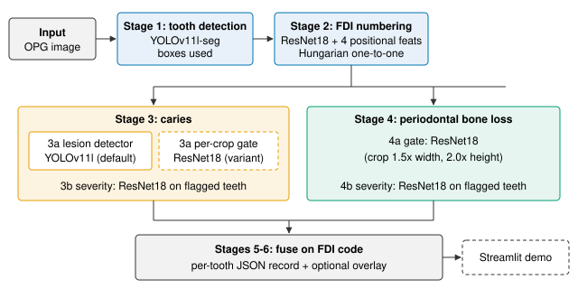
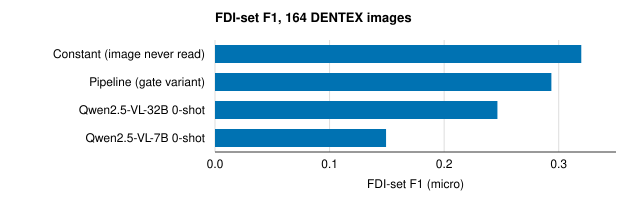
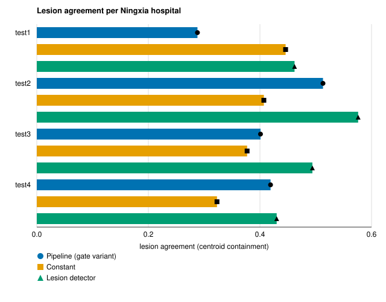
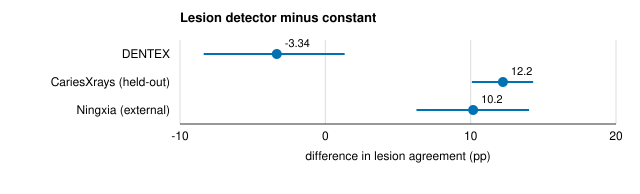
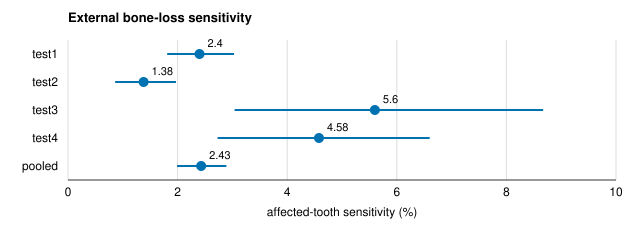

# What a Tooth-Level Score Cannot Tell You: Constant Baselines, External Validation and Domain Shift in Automated Panoramic Dental Screening

[ASK AUTHOR: author names, affiliations and e-mail addresses]

## Abstract

Automated caries screening on panoramic dental radiographs (orthopantomograms (OPGs)) is usually scored by which teeth a system flags. We ask whether that score can separate a system that reads the image from one that only knows where caries tends to occur. We built a six-stage pipeline that detects, numbers and classifies each tooth for caries and periodontal bone loss, and scored its per-crop caries-gate variant against two vision-language models and a constant that names the same eight first and second molars for every image. On 164 development images checked for byte-level leakage, the constant scored F1 0.320 against the pipeline's 0.294. On 1,500 images of a second public benchmark it reached lesion agreement 0.561 against 0.309, and on 337 images from four external hospitals the two were level (0.399 and 0.408). A lesion detector, registered in advance, reached 0.500 on those external images, above both the constant and the gate, while flagging fewer teeth; that cohort informed the pre-registered choice between two training mixtures. Numbering, and calibration and abstention measured on the gate variant, produced outputs a constant cannot produce, although none was compared with a position-only control. The periodontal branch detected 49 of 59 diseased validation crops in domain (sensitivity 0.8305) but only 2.4% of affected teeth at the external hospitals. We interpret these results as indicating that, for this pipeline, a tooth-level score alone was not sufficient evidence that it reads the radiograph. No clinician comparison was made, and the lesion-detector result rests on one fully external cohort and does not isolate the task change from changes of architecture and training data.

**Index Terms**: panoramic radiography, dental caries, periodontal bone loss, evaluation methodology, image-blind baselines, external validation, calibration, selective prediction

## I. Introduction

A panoramic radiograph (orthopantomogram (OPG)) shows every tooth and the supporting bone in one exposure. Dental caries (tooth decay) and periodontal bone loss are both visible on it. The authors' motivation for automating its reading is a second pass over images a clinician has already read, to flag findings that may have been missed. They also keep a periodontal branch that fails outside its training domain, because it shows that an in-domain score is not evidence of a usable model.

Published systems for this task report high accuracies; for example, one tooth-numbering and cavity system reports numbering accuracy 0.998 on 935 radiographs (Zancan et al., 2025), and a periodontal classifier reports 98.39% accuracy (Bilal et al., 2024). Such results are typically reported per tooth: which teeth does the system call diseased, and how well does that list agree with the expert's. Caries, however, is not spread evenly across the mouth. A per-tooth score can therefore be earned partly by knowing where caries usually occurs, a form of shortcut (Geirhos et al., 2020). Whether published systems are compared with such an image-blind floor is not established here [CITATION NEEDED: systematic count of image-blind baselines in OPG caries evaluation].

We therefore ask three questions. RQ1: does tooth-level caries agreement separate a complete pipeline from an image-blind constant, on development data and on external cohorts? RQ2: does replacing the per-crop gate with a whole-image lesion detector, whose flagged teeth are derived from predicted lesion boxes, separate them? RQ3: on outputs a fixed code list does not produce (tooth identity, calibrated confidence, abstention), what does the pipeline measure? Throughout, a tooth-level score means a score over per-tooth decisions; Section V-C shows that the same metric did separate a system that places lesion boxes, so the claim of this paper concerns the gate-variant pipeline, not the metric in general.

To answer them we scored a six-stage pipeline against a ladder of systems with progressively less task-specific knowledge (the VLMs see the full image but were not trained for the task; the constant uses no caries information), under one scorer, two metric families and three cohorts. The contributions are:

1. A constant-baseline comparison on three cohorts, in which, on point estimates, the constant scored above the gate-variant pipeline on two and level with it on the third (Section V-A, V-B).
2. A pre-registered replacement of the per-crop caries gate by a whole-image lesion detector that met its acceptance rule on two of three cohorts, only one of which is external to it (Section V-C).
3. Numbering results, and calibration and selective-prediction results on the gate variant with a comparator calibrator and a shuffle control, reported as outputs a fixed code list does not produce (Section V-D).
4. A measured negative result: a periodontal branch whose in-domain score does not transfer to external hospitals (Section V-F).

Section II places the work; Section III describes the system; Section IV, the evaluation; Section V, the results; Section VI, their interpretation; and Section VII, the limitations.

## II. Related Work

**Datasets.** This work uses four public panoramic datasets: the Tufts Dental Database of 1,000 radiographs with expert labels (Panetta et al., 2022), the Dental Enumeration and Diagnosis (DENTEX) challenge data (Hamamci et al., 2023), the CariesXrays benchmark of 6,000 radiographs released with its feature-pyramid contrastive learning (FPCL) detector (Chen et al., 2024), and a multi-centre cohort annotated for impacted teeth, periodontitis and caries (Li et al., 2024).

**Reported performance.** Classification and numbering systems on panoramic data report high in-domain figures (Zancan et al., 2025; Bilal et al., 2024). In one comparison with dentists, a periodontal bone-loss model reported weighted F1 0.29 and F1 of 0 for severe bone loss (Cerda Mardini et al., 2024). Methods for limited panoramic data have also been proposed (Cao et al., 2024). This paper does not rank itself against these works; it asks what the per-tooth score they share can support.

**Shortcuts and calibration.** Deep networks can learn shortcut solutions that match the target on the training distribution without learning the intended signal (Geirhos et al., 2020); an image-blind constant is a direct test for one such shortcut. Modern networks are often poorly calibrated, and temperature scaling is a one-parameter correction (Guo et al., 2017); isotonic regression is a non-parametric alternative (Zadrozny et al., 2002). We use both as calibration comparators.

**Vision-language models.** A vision-language model (VLM) takes an image and a written instruction and answers in text. We use the Qwen2.5-VL series (Bai et al., 2025) as general-purpose comparators, because they need no task-specific training and can therefore sit on the ladder between the pipeline and the constant.

## III. System

The implemented system maps one OPG to a per-tooth record in six stages, run from a single script and wrapped in a browser demonstration (Figure 1). Table 1 lists the models.

**Figure 1.** Architecture of the implemented pipeline, derived from the repository's inference script and its default checkpoints. Stage 3a has two selectable implementations; the lesion detector is the default.

**Stage 1** detects teeth with a YOLOv11l segmentation model from the Ultralytics You Only Look Once (YOLO) package (Jocher et al., 2023), used for its boxes. **Stage 2** assigns each detected tooth a code in the two-digit notation of the World Dental Federation (FDI), in which the first digit is the quadrant (1 upper right, 2 upper left, 3 lower left, 4 lower right) and the second the position from the midline (1 central incisor to 8 third molar). A ResNet18 (He et al., 2016) consumes the tooth crop and four positional features, and the Hungarian method (Kuhn, 1955) resolves the scores to a one-to-one assignment so that no two teeth share a code. The numbering head was trained on DENTEX and Tufts tooth crops.

**Stage 3** reports caries. Its default is a whole-image YOLOv11l lesion detector: each predicted lesion box is assigned to the detected tooth box it overlaps most, and those teeth are flagged. The authors changed to this formulation because a prior over tooth positions cannot place a lesion box. The detector's training list pools 9,600 samples per epoch, 4,800 CariesXrays images and 650 DENTEX images replicated to equal weight, and its confidence threshold was fixed at 0.25 in advance. A per-crop ResNet18 caries gate, trained on DENTEX tooth crops from 260 images whose splits do not overlap the 250-image evaluation set, the earlier formulation, is retained as a selectable variant; a ResNet18 severity head grades flagged teeth in both paths. **Stage 4** is a ResNet18 bone-loss gate followed by a ResNet18 severity grader. Bone-loss crops are expanded 1.5 times in width and 2.0 times in height, because teeth are about three times taller than wide. No bone-loss repair was attempted, because DENTEX carries no bone-loss labels and the multi-corpus remedy is therefore unavailable. **Stages 5 and 6** fuse the per-stage outputs on the FDI code and emit the record.

**Table 1.** Pipeline stages and learnable parameter counts read from the saved checkpoints.

| Stage | Model | Parameters |
|---|---|---|
| 1 Tooth detection | YOLOv11l-seg | 27.62 M |
| 2 FDI numbering | ResNet18 + 4 positional features | 11.19 M |
| 3a Caries localisation (default) | YOLOv11l detector | 25.31 M |
| 3a Caries gate (variant) | ResNet18 | 11.18 M |
| 3b Caries severity | ResNet18 | 11.18 M |
| 4a Bone-loss gate | ResNet18 | 11.18 M |
| 4b Bone-loss severity | ResNet18 | 11.18 M |
| Total (default) | | 97.65 M |

The default pipeline has 97.65 M learnable parameters, and the caries path with the gate variant 61.16 M; in the ladder run it averaged 2.386 s per image on a central processing unit (CPU).

## IV. Experimental Setup

**Data.** Table 2 summarises the cohorts. Tooth detection and the bone-loss branch were developed on Tufts under a frozen 700/150/150 image-level split. The caries evaluation uses the DENTEX disease subset of 250 images. The Ningxia cohort (four hospitals, test1 to test4) and CariesXrays were not used to train any model in the ladder comparison. All splits are image-level, because crops from one radiograph are not independent.

**Training data and disjointness.** The lesion detector's DENTEX boxes come from a DENTEX subset other than the 250-image evaluation set, which its pre-registration forbids as training data, and it is scored on CariesXrays' 1,200-image validation split, disjoint from its 4,800 training images by construction. The caries gate's 863 test crops come from 34 DENTEX images of the gate's own held-out split. The scope of each leakage check differs by model: the MD5 check below covered the numbering and detector training images; the gate's crop splits record 0 overlap with the 250-image evaluation set; for the lesion detector's DENTEX training images, disjointness rests on subset membership and its pre-registration, and a hash check against the 164 scored images is not recorded [ASK AUTHOR: was it run?].

**Table 2.** Cohorts used for evaluation.

| Cohort | Images scored | Role |
|---|---|---|
| DENTEX disease subset | 164 of 250 | development (caries, numbering) |
| Tufts | 150 test | detector, bone loss (validation 1,558 crops) |
| Ningxia, 4 hospitals | 337 caries, 736 periodontal | external |
| CariesXrays | 1,500 random draw | external for the ladder |

**Leakage control.** Message-digest (MD5) hashing found 86 DENTEX images byte-identical to images used in training (85 in numbering, 1 in detection); these were excluded, leaving 164 scored images.

Additional caveat: the check is byte-level, so near-duplicates and same-patient images cannot be excluded.

**The ladder.** Four systems answer one question, which teeth in this radiograph show caries, on the same 164 images: (1) the pipeline, with the per-crop caries gate that was the default when the ladder was run; (2) Qwen2.5-VL-32B-Instruct, zero-shot, 33.45 B parameters as loaded; (3) Qwen2.5-VL-7B-Instruct, zero-shot, 8.29 B parameters; (4) an image-blind constant. The constant was chosen by greedy search over tooth codes on the 78 excluded images that carry at least one caries annotation, frozen, and applied unchanged: {16, 17, 26, 27, 36, 37, 46, 47}, the first and second molars of all four quadrants. Under FDI-set scoring it reads nothing from the image. Under lesion agreement it flags the detected teeth to which the pipeline's numbering stage assigns one of the eight codes, so it uses tooth positions from the image but no caries information. The VLM prompt described the image as an OPG, gave the FDI scheme and valid codes, allowed absent teeth and asked for a code list or the word none; decoding settings were not recorded with the runs [ASK AUTHOR: VLM decoding settings, e.g. sampling and maximum tokens]. For the two vision-language models we also presented a blank grey image and a random-noise image under the same prompt.

**Metrics.** FDI-set precision, recall and F1 treat each image as a set of carious tooth codes; true positives, false positives and false negatives are pooled over all images before the ratios are taken. Lesion-localisation agreement is the fraction of annotated lesions that overlap a flagged tooth. On DENTEX lesions are matched greedily one-to-one by best IoU of at least 0.30, falling back to centroid containment for a lesion below that threshold; on external cohorts by centroid containment, because true matches there have IoU of only 0.015 to 0.124. Agreement has no negative class, so we report the number of teeth flagged beside it, and the match rate, the fraction of flagged teeth that contain at least one annotated lesion. Periodontal findings are scored by affected-tooth sensitivity. For calibration, both calibrators were fitted on the gate's validation split and evaluated on its test split, and isotonic regression is applied to the reported confidence only, so the published verdicts remain the measured ones.

**Statistics.** Confidence intervals (CIs) are 95% percentile cluster-bootstrap intervals over images, 10,000 resamples, seed 42; differences between systems on shared images are paired. Images, not teeth, are the resampling unit because errors are correlated within an image. External results are reported per hospital, because pooling hides between-site variation.

**Pre-registration.** The lesion-detector acceptance rule was frozen at commit ef3f453 of the project repository before any detector was trained; no public record of it exists yet [ASK AUTHOR: public anchor for the pre-registration, e.g. a repository tag or OSF record]. It declared both training mixtures (CariesXrays only, and CariesXrays pooled with DENTEX), the three cohorts, the comparators, the metric and the fixed 0.25 confidence, and the rule: exceed both the constant and the gate on at least two of three cohorts, at no more than 1.5 times their rate of flagging teeth.

## V. Results

### A. RQ1 on development data

*Observed.* Figure 2 and Table 3 give the ladder on DENTEX. The constant scored F1 0.320 (P 0.218, R 0.600), the pipeline 0.294, Qwen2.5-VL-32B 0.246 and Qwen2.5-VL-7B 0.149. A constant fitted directly on the scored images, which is not deployable, reached 0.330.

**Figure 2.** The image-blind constant scored the highest FDI-set F1 (0.3197) of the four systems on 164 leakage-free DENTEX images; values from the saved comparison outputs, micro-averaged over carious teeth.

**Table 3.** Tooth-level caries prediction on 164 DENTEX images, micro-averaged over 477 annotated carious teeth.

| System | Precision | Recall | F1 |
|---|---|---|---|
| Constant (image never read) | 0.218 | 0.600 | 0.320 |
| Pipeline (gate variant) | 0.235 | 0.390 | 0.294 |
| Qwen2.5-VL-32B, zero-shot | 0.250 | 0.243 | 0.246 |
| Qwen2.5-VL-7B, zero-shot | 0.248 | 0.107 | 0.149 |

Under lesion-localisation agreement on the same images (479 lesions), the constant matched 234 lesions (0.489) and the pipeline 212 (0.443); they flagged 859 and 755 teeth at match rates 0.272 and 0.281, and flagging every detected tooth reached 0.722 with 3,344 teeth.

*Interpretation.* Both metrics placed the constant ahead on this cohort. They are not independent evidence: they share images and flags, and lesion agreement rises with the number of teeth flagged, which was larger for the constant.

Additional caveat: neither DENTEX difference has an interval in this draft.

Additional caveat: the paired interval for the DENTEX difference is not in a saved artifact and is not reported here [MISSING RESULT: paired CI, DENTEX constant minus pipeline].

### B. RQ1 on external cohorts

*Observed.* On 337 Ningxia images (1,013 lesions; Figure 3), pooled agreement was 0.408 for the pipeline and 0.399 for the constant, at 6.246 and 5.789 flagged teeth per image; per hospital the constant-minus-pipeline difference ranged from +15.8 points at test1 to -10.6 points at test2. On 1,500 randomly drawn CariesXrays images (3,421 lesions), the constant reached 0.561 and the pipeline 0.309, and the constant flagged 9,672 teeth against 5,906 at match rates 0.206 and 0.189.

**Figure 3.** The constant-versus-pipeline ordering reversed between hospitals (test1 0.446 vs 0.288; test2 0.407 vs 0.513), while the lesion detector was highest at all four; values from the saved external-evaluation outputs; no per-site intervals.

*Interpretation.* The ordering on development data did not replicate on Ningxia, and on CariesXrays the constant was ahead both in agreement and in match rate.

*Not established.* Internal and external agreement use different matchers and are not comparable to each other.

Additional caveat: the pooled Ningxia and CariesXrays paired intervals are omitted for the same reason as above.

### C. RQ2: replacing the per-crop gate

Five direct changes to the per-crop gate were each pre-registered and scored by the change in average precision (AP) on its 863 test crops from 34 images, paired over images: CLAHE contrast equalisation +0.0488 [-0.0031, +0.0993], 1.25 times crop expansion +0.0198 [-0.0367, +0.0810], position-balanced sampling +0.0432 [-0.0328, +0.1157], a retrain with 2.67 times the positives -0.0015 [-0.0886, +0.0821], and per-type thresholds changed F1 by +0.006 [-0.034, +0.041]. None of the intervals excludes zero, but they are wide, so effects of the size observed cannot be ruled out; these repairs were not scored against the constant. The caries stage was then replaced by whole-image lesion detection.

*Observed.* The lesion detector met the pre-registered rule on two of three cohorts (Table 4, Figure 4). It flagged fewer teeth per image than both comparators on every cohort, at 0.305 to 0.664 of the constant's rate and 0.493 to 0.698 of the gate's. Per Ningxia hospital it reached 0.462, 0.576, 0.494 and 0.430 for test1 to test4, the highest of the three systems at each (Figure 3). A detector trained on CariesXrays alone, the other pre-declared mixture, reached 0.694 on CariesXrays but 0.086 on DENTEX and 0.240 on Ningxia. Because the rule selecting between the two mixtures includes Ningxia, the external cohort informed which detector was adopted.

**Table 4.** Lesion agreement of the three Stage-3a comparators and the lesion detector's paired differences, percentage points with 95% CIs.

| Cohort | Gate | Constant | Lesion detector | vs constant | vs gate |
|---|---|---|---|---|---|
| DENTEX | 0.443 | 0.489 | 0.455 | -3.34 [-8.37, +1.33] | +1.25 [-3.19, +5.70] |
| CariesXrays (held-out) | 0.317 | 0.562 | 0.684 | +12.22 [+10.08, +14.30] | +36.73 [+34.40, +39.02] |
| Ningxia (external) | 0.408 | 0.399 | 0.500 | +10.17 [+6.27, +14.02] | +9.28 [+5.31, +13.29] |

**Figure 4.** The lesion detector exceeded the constant on Ningxia (+10.17 pp) and CariesXrays (+12.22 pp) and tied on DENTEX, where the interval includes zero; whiskers are 95% paired cluster-bootstrap intervals; values from the saved acceptance-rule outputs.

*Interpretation.* The result is consistent with the change of task separating the system from the prior on Ningxia. The comparison does not isolate the task: the detector also differs from the gate in architecture and training data, and the single-corpus arm shows that the training mixture mattered, since its own-corpus score was the highest of any arm while it failed elsewhere.

Additional caveat: none of the five gate repairs added the CariesXrays training data, so formulation and data are confounded.

*Not established.* Only Ningxia is external to the lesion detector, since both of its training corpora are cohorts in this comparison.

Additional caveat: the CariesXrays row uses a 1,200-image held-out split, not the 1,500-image draw of Section V-B.

### D. RQ3: outputs a constant cannot produce

**Numbering.** Detection recall was 70.6%, end-to-end FDI-exact numbering 58.3% (546 of 936 teeth, 95% CI [53.9, 62.8]), and 82.6% of the 661 detected teeth were numbered exactly (95% CI [79.1, 85.8]). Of the 115 wrong codes, 89 were off by one position within the correct quadrant, and 16 of 661 detected teeth received a quadrant-level error. The Stage-1 detector reached box mAP@0.5 0.8100 on the Tufts test split; its mask mAP@0.5 was 0.6383, below the pre-registered bar of 0.65, and the model is used for boxes only. No position-only numbering baseline was run.

Additional caveat: without such a control, these results show that numbering is informative, not that its information comes from the image rather than from tooth order.

**Calibration.** These results describe the per-crop gate variant. On 863 held-out crops its expected calibration error (ECE) was 0.136; temperature scaling gave 0.152 and isotonic regression 0.043, at an average-precision cost from 0.550 to 0.500, and isotonic regression would change 155 of 863 verdicts at the 0.5 threshold. Isotonic regression reduced the test scores to 46 distinct values, and the resulting ties lowered average precision. We have no measured explanation for why temperature scaling increased ECE, and ECE has no interval here.

**Selective prediction.** Declining the least-confident quarter raised numbering accuracy from 0.826 to 0.885 (+5.91 points, 95% CI [+3.88, +7.68]) and caries-gate accuracy from 0.797 to 0.940 (+14.25 [+11.32, +16.63]); with shuffled confidences the gains were +0.03 and +0.00 points; the pre-registered 0.30 threshold gave 90.8% coverage at 0.847 accuracy.

*Interpretation.* The shuffle control indicates that the gains come from the confidence ranking and not from discarding items.

### E. Vision-language model behaviour

*Observed.* Qwen2.5-VL-32B answered "none" to the blank image and 16, 17, 26, 27, 36, 37, 46, 47 to random noise; Qwen2.5-VL-7B answered 26,36 to the blank image, to noise and to a real radiograph. Few-shot prompting lowered Qwen2.5-VL-7B F1 from 0.149 to 0.066 with two examples and 0.034 with four.

*Interpretation.* These answers are consistent with the models emitting a population prior rather than reading the image, for these two models under this prompt.

### F. The periodontal branch: a negative result

*Observed.* The bone-loss gate reached macro-F1 0.9233 on 1,558 Tufts validation crops (59 diseased; sensitivity 0.8305, specificity 0.9953). On 736 Ningxia periodontal images the branch reached pooled affected-tooth sensitivity 2.4% (95% CI [2.0, 2.9]), between 1.4% and 5.6% across the four hospitals (Figure 5).

**Figure 5.** External bone-loss sensitivity stayed below 9% at every Ningxia hospital (pooled 2.43%); whiskers are 95% cluster-bootstrap intervals over 736 images; values from the saved bootstrap outputs.

*Not established.* The in-domain figure is the best of 32 epochs, selected on the same validation set, and is an upper bound rather than an estimate.

Additional caveat: the external drop is not separated into image-domain shift, label-definition differences and threshold choice.

## VI. Discussion

**RQ1.** For the gate-variant pipeline, point estimates of tooth-level caries agreement were not above the image-blind prior on any of three cohorts: the constant was ahead on DENTEX and CariesXrays and level on Ningxia. Without the paired constant-minus-pipeline intervals this is a statement about point estimates; it is not a test of equivalence. The supported statement is non-separability, not that the constant is the better system. One hypothesis, not tested here, is that caries in these cohorts is concentrated in the molars, so that a fixed molar answer collects part of the achievable score; a per-tooth-type count of annotated lesions would test it.

Additional caveat: that concentration was not measured in a saved artifact for this draft.

**RQ2.** A detector whose flagged teeth come from predicted lesion boxes was separated from the prior on Ningxia; the five earlier repairs were judged only by AP on the gate's test crops, not against the prior. The result rests on one fully external cohort.

Additional caveat: every model is a single training run.

**RQ3.** Tooth identity, calibration against a comparator calibrator and abstention with a shuffle control are outputs that a fixed code list does not produce; per-site external results, which the constant does have, remain necessary beside them. We propose them as additional reporting axes.

Additional caveat: they would need their own image-blind controls, such as position-only numbering and confidence, before they could count as evidence of image reading.

**Implication.** For systems like the one tested here, we interpret a tooth-level caries score reported without an image-blind row and without per-site external results as insufficient evidence that the system reads the radiograph.

## VII. Limitations

The authors state the following limitations.

- The adopted lesion detector has no calibrated confidence and no abstention curve; the calibration and selective-prediction results describe the gate variant.
- No clinician comparison was made, so no clinical-utility claim is possible.
- The caries cohorts disagree in direction; the supported claim is non-separability.
- Internal and external agreement figures use different matchers and are not comparable.
- Localisation is tooth-level only.
- The external cohort has no healthy controls, so specificity and the area under the receiver operating characteristic curve are not computable.
- Unmatched flagged teeth are not confirmed false positives; the match rate is not precision.
- Only one VLM family at two scales was tested.
- Detection bounds numbering, and coverage figures are fractions of detected teeth.
- The in-domain bone-loss figure is a selected maximum, and its validation set cannot be regenerated from source.
- Bone-loss labels are weak supervision from one institution.
- Patient-level separation cannot be verified on DENTEX.
- All data are retrospective.
- The lesion detector is supported by one fully external cohort.
- Ningxia test2 shares a centre with the source cohort's own training portion and is the pipeline's best site.
- The test1 result is unexplained.

**Additional caveats.** Every trained model is a single run, so no seed variance is available. The CPU model behind the latency figure is not recorded. Related work is supported at abstract or title level only. The paired constant-minus-pipeline intervals are not in a saved artifact and are omitted. The two CariesXrays rows use different image sets. Two figures available only in project notes, the bone-loss firing rate on DENTEX and the molar concentration of CariesXrays lesions, are omitted. The lesion detector's gain is confounded with its architecture and training data. Numbering, calibration and abstention lack a position-only control. The bone-loss drop is not attributed to a type of shift. Leakage checks are byte-level. Lesion agreement rises with the number of teeth flagged, and the DENTEX ordering has no interval here.

## VIII. Conclusion

On three cohorts, on point estimates, a constant naming the eight first and second molars scored above a six-stage pipeline's gate variant on tooth-level caries agreement on two cohorts and level with it on the third; paired intervals for these differences are still missing. A pre-registered lesion detector exceeded both the constant and the gate on the fully external cohort, by 10.17 and 9.28 points, although that comparison does not isolate the change of task. Numbering, calibration and abstention gave outputs a constant cannot produce, but without position-only controls they are not yet evidence of image reading, and the periodontal branch did not transfer. We propose reporting an image-blind row and per-site external results beside any tooth-level caries score; future work should add position-only controls, calibrate the lesion detector and compare with clinicians.

## Acknowledgment

[ASK AUTHOR: confirm wording] This manuscript draft was prepared with the assistance of the Research Communication Engine and the Claude Opus 5.5 model, which drafted text from the project's saved evaluation artifacts under the authors' direction. The authors are responsible for its content.

## References

- Bai, S., et al. (2025). Qwen2.5-VL Technical Report. arXiv:2502.13923.
- Bilal, A., et al. (2024). PDCNET: Deep Convolutional Neural Network for Classification of Periodontal Disease Using Dental Radiographs. IEEE Access.
- Cao, Z., et al. (2024). DPML: Prior-guided multitask learning for dental object recognition on limited panoramic radiograph dataset. Expert Systems with Applications.
- Cerda Mardini, D., et al. (2024). Determining the efficacy of a machine learning model for measuring periodontal bone loss. BMC Oral Health.
- Chen, B., et al. (2024). CariesXrays. Proc. AAAI.
- Geirhos, R., et al. (2020). Shortcut learning in deep neural networks. Nature Machine Intelligence.
- Guo, C., et al. (2017). On Calibration of Modern Neural Networks. ICML.
- Hamamci, I. E., et al. (2023). DENTEX. arXiv:2305.19112.
- He, K., et al. (2016). Deep Residual Learning for Image Recognition. CVPR.
- Jocher, G., et al. (2023). Ultralytics YOLO. Software.
- Kuhn, H. W. (1955). The Hungarian method for the assignment problem. Naval Research Logistics Quarterly.
- Li, X., et al. (2024). A Multi-center Dental Panoramic Radiography Image Dataset. J. Imaging Informatics in Medicine.
- Panetta, K., et al. (2022). Tufts Dental Database. IEEE JBHI.
- Zadrozny, B., et al. (2002). Transforming classifier scores into accurate multiclass probability estimates. KDD.
- Zancan, B. G., et al. (2025). AI-powered precision in dental radiographic analysis. PLOS Digital Health.
